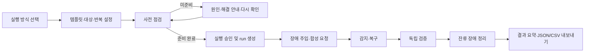
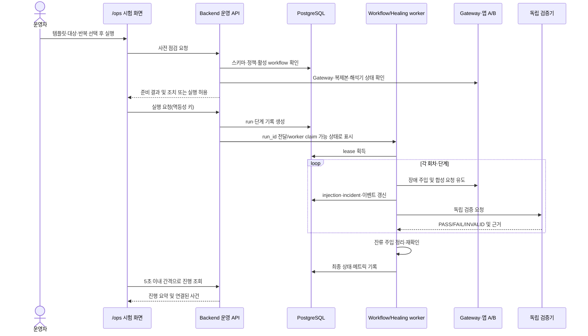

# 장애복구 시스템 구현 기획서

> **요구사항 기준:** 이 문서는 사용자와의 현재 채팅에서 확정된 요구사항을 최우선으로 삼는다. 기존 PRD·설계서와 내용이 다르면 이 문서의 기준으로 정합성을 고친다. 이 문서는 코드에 이미 들어간 기능과 앞으로 구현할 기능을 구분하며, 미구현 기능을 완료된 것으로 표현하지 않는다.

## 목차

1. [문서 목적과 기준](#1-문서-목적과-기준)
2. [현황과 구현 목표](#2-현황과-구현-목표)
3. [제품 원칙과 사용자 흐름](#3-제품-원칙과-사용자-흐름)
4. [시스템 구조](#4-시스템-구조)
5. [F-1~F-6 자동 복구 정책](#5-f-1f-6-자동-복구-정책)
6. [고의 장애 workflow](#6-고의-장애-workflow)
7. [운영자 UX와 API](#7-운영자-ux와-api)
8. [데이터와 상태 모델](#8-데이터와-상태-모델)
9. [정책 일치·안전·보안](#9-정책-일치안전보안)
10. [검증과 완료 기준](#10-검증과-완료-기준)
11. [단계별 구현 순서](#11-단계별-구현-순서)
12. [미결 사항과 결정 기록](#12-미결-사항과-결정-기록)

---

## 1. 문서 목적과 기준

이 문서는 Moa 자동 복구 기능과 고의 장애 시험을 운영자가 실제로 사용할 수 있도록 구현 범위, 구성요소 책임, 데이터 흐름, UI, 안전 장치 및 완료 조건을 정한다. 문서만 맞추는 것이 아니라 이후 코드·API·테스트·배포 설정이 이 구조를 따르게 한다.

요구사항의 적용 순서는 다음과 같다.

1. 현재 채팅에 명시된 요구사항과 정책 값
2. 이 구현 기획서에 명시된 상세 계약
3. 기존 PRD·아키텍처 설계서·시스템 정의서
4. 현재 코드 동작

기존 문서의 내용이 위 기준과 충돌하면 구현 기준을 이 문서에 맞추고, 구문서에 남은 값은 정본인 것처럼 참조하지 않는다. 정책 임계값은 별도 자동장애복구 정책 원문에 정의된 값을 코드와 설정에 그대로 반영한다. 정책 원문과 대조가 끝나지 않은 값은 추측으로 확정하지 않는다.

### 1.1 용어

| 용어 | 의미 |
|---|---|
| 장애 유형 | F-1~F-6으로 식별하는 복구 대상 장애 |
| 사건(`incident`) | 감지된 장애와 진단·복구·검증 결과를 담는 운영 기록 |
| workflow | 한 번의 장애 시험을 구성하는 순차 단계와 반복 실행 |
| 주입(`injection`) | 지정된 대상에 장애를 켜고 정해진 시간 또는 정리 동작까지 유지하는 행위 |
| 합성 요청 | 시험 목적으로 생성한 가짜 주문·세션 요청. 실제 업무 데이터와 분리한다 |
| 독립 검증 | 복구 액션을 실행한 코드와 분리된 검증자가 기능 정상 여부를 판정하는 과정 |
| `completed` | 장애 주입 workflow의 단계가 끝났다는 뜻. 복구 성공을 뜻하지 않는다 |
| 정책 정본 | 임계값·재시도·복귀 조건을 정의하고 배포 검사에서 읽는 버전 관리 정책 파일 |

---

## 2. 현황과 구현 목표

### 2.1 현재 기반

| 영역 | 현재 확인된 기반 | 남은 연결·구현 |
|---|---|---|
| F-1·F-2 | 규칙 기반 폴백과 제한시간 처리가 있음 | 실패 상태 갱신, 회로 상태 연동, 반대 인터프리터로의 제한된 전환, 사건화 및 독립 검증 |
| F-3 | A/B Gateway와 앱 복제본 배포 구조가 있음 | 별도 worker가 Gateway 우회 상태를 확인하고 허용목록 backend를 복구·검증하는 동작. A/B 전환과 단일 A 재시작을 분리 시험 |
| F-4 | 회로 차단기 로직 일부가 있음 | 실제 인터프리터 요청의 실패·성공 결과와 연결하고 동시성, 양쪽 차단, 복귀 단일 probe를 통합 |
| F-5 | 잘못된 출력 주입, 계약 검증과 재생성 경로가 있음 | 검증 오류를 재생성 입력에 전달하고 최대 횟수 이후 `NEEDS_REVIEW`로 종료 |
| F-6 | 메뉴 DB 실패 주입과 동일 브랜드·버전의 stale cache fallback이 있음 | 세션 pinning, backend 준비 전 preload, checksum 검증, 단일 메뉴 조회 실패와 전체 DB 장애 구분 |
| workflow 실행 | DB 저장 및 실행 서비스가 단계 1~20개, 반복 1~10회, 주입 1~120초를 검증하고 `run_id`·`injection_id` 기록 | `/ops` API/UI와 실제 worker 실행 연결, incident 연결, 안전 중지·lease, 합성 업무 흐름, 결과 보고 |

위 현황은 본 기획서 작성 시점의 기준선이다. 기존 UI의 버튼이나 fault injection endpoint만으로 workflow 실행·자동 복구 완료로 간주하지 않는다.

### 2.2 목표 상태

1. F-1~F-6 각각에 감지 조건, 제한된 복구 전략, 독립 검증 및 미복구 종료를 연결한다.
2. 운영자는 `/ops`의 장애 시험 화면에서 권장 템플릿을 고르고 사전 점검 후 한 번의 실행으로 시험한다.
3. 모든 시험은 lab 환경과 명시된 상한을 확인한 뒤에만 장애를 주입한다.
4. 주입 단계, 사건, 합성 요청, 복구 시도, 검증 결과를 `run_id`, `injection_id`, `incident_id`로 추적한다.
5. 중지·예외·worker 재시작 시 남은 주입을 해제하거나 안전하게 lease를 인수한다.
6. 테스트 결과를 회차별·장애별로 집계하고 JSON/CSV로 내보낸다.
7. 정책 원문, 실행 설정, 앱 구현이 다르면 배포를 차단한다.

### 2.3 범위 밖

- production 환경에서 고의 장애를 주입하지 않는다.
- workflow 실행을 실제 주문·고객 세션 데이터에 적용하지 않는다.
- 병렬 장애 주입을 기본 시험 흐름에 포함하지 않는다. 병렬은 별도 안전성 시험으로 격리한다.
- 로그·컨테이너 상태만으로 복구 성공을 선언하지 않는다.
- workflow 정리 기능에서 DB 볼륨이나 실제 업무 데이터를 초기화하지 않는다.

---

## 3. 제품 원칙과 사용자 흐름

### 3.1 핵심 원칙

- **실행 전 차단:** 준비 조건을 하나라도 만족하지 못하면 주입 API를 호출하지 않는다.
- **실패 안전:** 작업이 중단되어도 주입이 무기한 남지 않도록 TTL·lease와 정리 경로를 둔다.
- **단일 실행:** 한 시점에 활성 workflow는 하나만 허용한다.
- **실제 경로 검증:** 장애는 사용자의 실제 backend→interpreter→DB 흐름에 주입하고 합성 요청으로 결과를 확인한다.
- **판정 분리:** 장애 주입 종료, 복구 성공, 기능 검증 성공은 서로 다른 상태와 지표로 기록한다.
- **운영자가 이해할 결과:** 화면에는 상태 요약과 해결 방법을 우선 노출하고, 원문 로그는 상세 링크에서 제공한다.
- **업무 데이터 격리:** 모든 시험 생성 데이터와 정리 범위는 `run_id`로 제한한다.

### 3.2 시험자 여정

### 3.3 실행 모드

| 모드 | 동작 |
|---|---|
| 빠른 확인 | 선택한 시나리오 1회를 순차 실행해 준비 상태와 전체 흐름을 점검 |
| 정식 측정 | 자동장애복구 계획의 25회 행렬을 순차 실행. F-1·F-2·F-3·F-5·F-6 각 5회. F-3은 A/B 대상을 번갈아 포함 |
| 사용자 정의 | 검증된 템플릿을 기반으로 단계·대상·반복·간격을 조정. 고급 정책은 접힌 별도 편집 영역에서 설정 |

정식 측정은 각 회차 전 회로와 시험 데이터를 기준 상태로 되돌린다. F-4는 cooldown과 단일 probe를 포함하는 별도 안전성 시험이며 25회 성공률 분모에 넣지 않는다.

---

## 4. 시스템 구조

### 4.1 구성요소와 책임

| 구성요소 | 책임 | 해서는 안 되는 일 |
|---|---|---|
| `/ops` frontend | 모드·템플릿 선택, 사전 점검 결과, 진행·중지·결과 표시 | 장애 복구를 직접 실행하거나 업무 API를 우회하지 않는다 |
| Backend 운영 API | 인증·요청 검증, 사전 점검 집계, workflow 생성·조회·중지, 결과 내보내기 | worker 액션을 요청 스레드에서 장시간 동기 실행하지 않는다 |
| Workflow service | 단계 순서, 반복, 상한, 중복 실행 잠금, 상태 전이 관리 | 정책에 없는 장애 코드·action을 조합하지 않는다 |
| Healing worker | lease 획득, 장애 감시·진단, 허용 action 실행, 주입 정리, 검증 요청 | 허용목록 밖 컨테이너 제어 또는 검증 전 성공 선언을 하지 않는다 |
| Gateway | 앱 A/B 상태 확인, 정상 복제본으로 요청 분배, 비정상 복제본 제외 | 사건 복구나 업무 데이터 정합성을 대신 판정하지 않는다 |
| Socket proxy | healing worker에 읽기 및 고정 allowlist 재시작 경로만 제공 | Docker socket 전체 권한이나 임의 명령을 노출하지 않는다 |
| PostgreSQL `app`·`healing` schema | 업무 데이터와 장애·workflow·사건·감사 기록을 분리 저장 | 시험 정리 요청으로 전체 DB·볼륨을 초기화하지 않는다 |
| Synthetic traffic runner | `run_id`가 붙은 시험 주문·세션을 만들어 정상/장애 경로로 전송 | 실제 고객 세션이나 기존 주문을 수정하지 않는다 |
| Independent verifier | 요청 결과, 데이터 무결성, 서비스 상태를 복구 실행과 독립적으로 판정 | 복구 action의 성공 응답만으로 PASS를 주지 않는다 |

### 4.2 논리 데이터 흐름

### 4.3 장애 처리 경로

서비스 복구(운영 중의 실제 장애 대응)와 고의 장애 workflow(시험)는 동일한 복구 action·정책·검증 코드를 공유한다. 시험 전용 허용 지점은 `ENVIRONMENT=lab`으로 제한하고, 시험은 실제 worker에 명시된 시나리오를 전달한다. UI에서 별도 규칙으로 복구를 흉내 내지 않는다.

---

## 5. F-1~F-6 자동 복구 정책

모든 유형은 아래 공통 순서를 따른다.

1. 관측 신호를 수집하고 정책 임계값을 판정한다.
2. 장애 유형과 대상·증거를 포함해 incident를 생성 또는 기존 incident와 연결한다.
3. 회로 상태·동시 실행·허용 action을 확인한다.
4. 정책에 정의된 최대 횟수와 시간 상한 안에서 복구한다.
5. 복구 실행과 분리된 검증기로 기능·데이터·상태를 확인한다.
6. 검증 통과 시에만 recovered를 선언한다. 그 외는 failed, awaiting approval, needs review 또는 operator action 필요로 남긴다.

### 5.1 유형별 구현 계약

| 유형 | 감지·사건화 | 복구 계약 | 독립 검증·실패 처리 |
|---|---|---|---|
| **F-1 HTTP 5xx** | 실제 interpreter 요청의 5xx를 기록하고 연속 실패·회로 상태를 갱신 | 회로 상태를 확인하고 반대 interpreter로 최대 1회 전환한다. 재시도 간격·추가 재시도는 자동장애복구 계획서의 값을 그대로 적용한다. 규칙 기반 폴백은 정책이 허용하는 요청 경로에서만 사용한다 | 복구 액션과 독립된 기능 요청·결과 계약을 검증하고 사건에 기록한다. 전환 실패나 검증 실패는 성공으로 숨기지 않는다 |
| **F-2 5초 초과 지연** | 정책 기준상 5초 초과를 지연 장애로 감지하고 요청 지연 증거를 기록 | F-1과 같은 실패 상태·회로 확인·반대 interpreter 최대 1회 전환 계약. 모든 재시도·전환을 합쳐 15초 시간 상한을 지킨다. 상한 경계 요청도 시험한다 | 15초 상한 안에서 정상 응답과 결과 계약을 확인한다. 상한을 넘으면 다음 작업을 중단하고 incident를 실패 또는 검토 상태로 남긴다 |
| **F-3 backend 중단** | Gateway가 backend `/ready`를 2초 간격으로 확인하고 대상 stack·컨테이너를 기록한다 | `/ready` 2회 연속 실패 시 장애 stack을 제외한다. B가 있으면 15초 이내 트래픽을 전환하고, 별도 healing worker가 허용목록 backend를 10분 안 최대 2회 재시작한다. A/B 전환과 단일 A 재시작을 분리한다 | backend 재시작 후 30초 안에 `/health`, `/ready`, frontend 연결을 확인한다. `/ready` 2회 연속 정상 후 Gateway에 재등록하고 기능 검증을 통과해야 회복으로 본다 |
| **F-4 반복 장애** | interpreter별 실제 요청 실패/성공 결과를 회로에 반영한다 | 인터프리터별 3회 연속 실패 후 60초 차단, 차단 종료 시 단일 probe만 허용한다. probe 동시성은 한 번으로 제한한다. 한쪽·양쪽 모두 차단된 상황의 종료 경로를 구현한다 | 실패 누적, cooldown 경계, 중복 probe 차단, probe 성공·실패 후 상태 전이를 검사한다. probe 실패는 `awaiting_approval`로 전환하고 자동 probe를 반복하지 않는다 |
| **F-5 잘못된 에이전트 출력** | fault 주입과 기존 계약 validator가 출력 오류를 사건 증거로 남긴다 | 검증 오류·기대 계약을 재생성 입력에 전달한다. 최초 생성 뒤 재생성은 최대 2회, 총 3회 생성으로 제한한다 | 매 출력을 다시 검증한다. 총 3회 생성 후에도 실패하면 주문을 `NEEDS_REVIEW`로 보내고 자동 완료·공유하지 않는다 |
| **F-6 메뉴 조회 실패** | 메뉴 단건 조회 실패와 DB 전체 연결 장애를 분리 분류한다 | 각 backend가 readiness 전에 `(brand_id, menu_version)`별 캐시를 준비한다. 동일 키·checksum이 일치하는 읽기만 stale cache로 fallback한다. 세션 pinning으로 사용 중 버전을 고정한다 | 캐시 브랜드·버전·checksum, 세션 pin, DB 전체 장애 판정을 검증한다. 안전한 동일 버전 캐시가 없거나 전체 DB 장애면 실패/검토로 남기고 임의 메뉴 결과를 만들지 않는다 |

### 5.2 지표와 정책 값

- 감지 임계값·메트릭 창·샘플 수·재시도 횟수·backoff·회로 복귀 조건은 기존 자동장애복구 계획서의 값을 사용한다. 현재 채팅에서 확정된 값과 충돌하면 채팅을 우선한다.

| 항목 | 반영할 기준값 |
|---|---|
| Monitor 감지 | 5초 간격 평가, 2회 연속 실패를 장애로 판정, 목표 MTTD 15초 이하 |
| Gateway readiness | `/ready` 2초 간격 확인, 2회 연속 실패 시 해당 앱 stack 제외, 2회 연속 정상 후 재등록 |
| F-1·F-2 interpreter 전환 | 요청당 반대쪽으로 최대 1회 전환, 같은 interpreter 재시도 및 왕복 전환 금지, 총 처리 상한 15초 |
| F-3 전환·재시작 | 대체 B가 healthy면 15초 내 전환. 기존 backend 재시작은 10분 안 최대 2회, 재시작 뒤 30초 안 health/readiness/frontend 검사 |
| F-4 circuit | interpreter별 3회 연속 transport 실패 시 차단, 60초 cooldown 후 단일 probe. probe 실패는 `awaiting_approval`, 자동 반복 금지 |
| F-5 생성 | 최초 출력 1회와 재생성 최대 2회, 총 3회. 소진 시 `NEEDS_REVIEW` |
| 독립 검증 | health/readiness/frontend 연결 3회 연속 정상. F-1은 합성 검증 요청 5건 실패 없음 |
| workflow 입력 | 단계 1~20개, 반복 1~10회, injection별 1~120초. 정책 정본이 더 낮게 제한하면 더 낮은 상한 적용 |
| 측정 목표 | MTTD ≤15초. MTTR은 F-1·F-2·F-5·F-6 ≤60초, F-3 ≤90초 |

- F-2의 장애 감지 기준은 5초 초과 지연이며, 전환 전체에 15초 상한을 적용한다.
- latency는 요청별 경과시간과 회차별 MTTD/MTTR을 함께 기록한다. 분모에서 제외 가능한 회차는 사전 준비 실패 또는 주입 도구 오류로 증거가 남은 무효 회차뿐이다.
- 기존 계획서의 API·DB·LLM 비율 기반 초기 운영 경보는 이번 기획서에서 상세 수치로 복제하지 않는다. 필요 시 정책 정본과 함께 별도 metric catalog로 관리한다.

---

## 6. 고의 장애 workflow

### 6.1 템플릿

각 F-1~F-6에 검증된 템플릿을 제공한다. 템플릿은 장애 코드만 나열하지 않고 대상, 사전조건, 단계, 주입 action, 자동 복구 기대, 독립 검증, 정리 절차, 안전 상한을 포함한다.

| 템플릿 필드 | 설명 |
|---|---|
| `template_id`, `version`, `fault_type` | 안정적인 템플릿 식별자와 정책 버전 |
| 대상 | A, B, primary, backup 등 고정 허용 대상 |
| 단계 | 순서, action, 대기시간, 주입시간, 이후 단계 정책 |
| 검증 계약 | 합성 요청 수·결과·무결성·서비스 복귀 판정 |
| 안전 제한 | 단계 수, 반복 수, 총 주입 시간, 허용 대상, 1회 활성 잠금 |
| 정리 계약 | 명시적 clear, TTL, lease 만료 회수, 정리 재확인 |

기본 제공 템플릿은 F-1~F-6 검증 시나리오다. 고급 편집은 복제본 템플릿에서만 허용하고, 검증되지 않은 action이나 허용목록 밖 대상을 저장·실행할 수 없다.

### 6.2 제한과 실행 잠금

현재 기반의 입력 범위인 단계 1~20개, 반복 1~10회, 주입 1~120초는 검증 가능한 기본 상한으로 보존한다. 정책 정본이 더 낮은 상한을 지정하면 더 낮은 값을 적용한다. 편집된 workflow에 대해 단계별뿐 아니라 반복을 곱한 총 주입시간도 계산해 실행 전에 제한한다.

- 한 번에 활성 workflow는 하나다. DB advisory lock 또는 동등한 원자적 잠금을 사용한다.
- 실행 API는 idempotency key를 받아 브라우저 재전송으로 중복 run이 생기지 않게 한다.
- 정상 실행은 순차다. 병렬 옵션은 기본 UX에 노출하지 않고 별도 안전성 시험 권한·템플릿으로 분리한다.
- 실행 직전 사전 점검 결과의 유효기간과 정책 version/hash를 확인한다. 오래되거나 버전이 달라졌으면 다시 점검한다.

### 6.3 실행 상태와 전이

| 상태 | 의미 |
|---|---|
| `queued` | 실행 요청 저장, worker claim 대기 |
| `preflight` | 실행 직전 준비조건 재확인 중 |
| `running` | 단계 실행 중 |
| `stop_requested` | 중지 요청 접수, 합성 요청 발생 즉시 차단 |
| `cleaning` | 활성 주입 해제·잔류 여부 확인 중 |
| `completed` | 주입 단계 종료 및 정리 완료. 복구 성공과 별개 |
| `stopped` | 중지가 정리까지 확인된 상태 |
| `failed` | workflow 자체 실행 실패 또는 시험 실패가 기록된 상태 |
| `needs_operator_action` | 10초 이내 정리가 확인되지 않거나 안전 복구를 자동 확정할 수 없는 상태 |
| `invalid` | 준비 실패 또는 주입 도구 오류가 증거와 함께 확인되어 측정에서 무효 처리된 상태 |

각 회차의 판정은 `PASS`, `FAIL`, `INVALID`, `AWAITING_APPROVAL`로 별도 저장한다. workflow `completed`가 회차 `PASS`를 자동으로 의미하지 않는다.

### 6.4 중지·예외·worker 재시작

1. 중지 요청을 DB에 원자적으로 기록한다.
2. 합성 요청 runner를 먼저 멈춘다.
3. 활성 `injection_id`를 조회하고 제한된 clear 액션을 실행한다.
4. 해당 대상에 주입이 남았는지 독립 확인한다.
5. 10초 이내 정리가 입증되면 `stopped`; 그 안에 확인되지 않으면 `needs_operator_action`으로 기록하고 화면에 강한 조치 안내를 표시한다.
6. worker는 heartbeat와 만료시각이 있는 lease를 갱신한다. worker 재시작 후 lease를 원자적으로 인수하고, 이전 worker의 stale lease가 남긴 주입을 확인·정리한다.
7. cleanup 시도·결과·시각을 append-only 이벤트로 보존한다.

주입은 DB 상태만 믿지 않고 각 injection의 최대 수명과 worker lease를 갖는다. 상태 기록과 실제 장애 상태가 어긋나는 경우 안전 정리 우선으로 reconciliation한다.

### 6.5 정식 측정 행렬

- 복구 가능 장애 F-1·F-2·F-3·F-5·F-6 각 5회, 총 25회 순차 실행.
- F-3는 A/B 복제본을 번갈아 대상에 넣어 양쪽 동작을 포함한다. 단일 A 재시작 케이스도 별도 표기한다.
- 회차 사이에 회로 상태·합성 데이터·주입 상태를 초기 기준으로 복원한다.
- F-4는 60초 cooldown과 단일 probe, 양쪽 차단 종료를 포함한 별도 안전성 시험으로 실행한다.
- `AWAITING_APPROVAL`, 사람 개입 회차, 검증 실패를 성공 분자에 넣지 않는다. 사람이 조치한 회차는 유효 분모에 남기고 결과를 명시한다.

---

## 7. 운영자 UX와 API

### 7.1 화면 구조

운영 대시보드 `/ops`에 `장애 시험` 영역을 둔다. 시험 영역은 다음 네 영역으로 구성한다.

| 영역 | 표시·동작 |
|---|---|
| 실행 선택 | 빠른 확인 / 정식 측정 / 사용자 정의. 권장 템플릿을 기본 선택하고 고급 설정은 접는다 |
| 사전 점검 | lab, DB·schema, Gateway, 앱 A/B, worker, Docker proxy, allowlist, 포트, interpreter 상태를 준비/미준비로 표시. 항목별 원인·해결·다시 확인 제공 |
| 실시간 진행 | 시나리오·회차·단계, 대상, 남은 시간, 합성 요청 수, 감지·복구·검증 결과, 중지 버튼, `run_id`와 incident ID |
| 결과 요약 | 전체·유형별 PASS/FAIL/INVALID/승인 대기, 성공률, MTTD/MTTR, 무결성, 실패 원인, incident/log 링크, JSON/CSV 내려받기 |

진행 단계는 `준비 확인 → 장애 주입 → 감지 → 복구 → 검증 → 정리`로 일관되게 표현한다. UI 갱신 간격은 5초 이내로 한다. 화면 문구는 운영 요약을 기본으로 하고 원문 로그는 상세 링크에서 제공한다. 비밀값·API 키·세션 토큰은 화면이나 내보내기 데이터에서 제거한다.

### 7.2 사전 점검 항목

| 검사 | 준비 판정 예시 | 미준비 때 조치 안내 예시 |
|---|---|---|
| 환경 | `ENVIRONMENT=lab` | lab 전환 절차 안내. production에서는 실행 버튼을 제공하지 않음 |
| DB·스키마 | 연결 가능, 필요한 schema/version 존재 | DB 시작·schema migration 명령과 재확인 버튼 |
| Core/Gateway | Gateway 응답과 stats 확인 | Core stack 상태·포트 확인 안내 |
| 앱 A/B | 필요한 복제본 health 확인 | 대상 stack 시작 및 실제 이름 확인 |
| worker | worker heartbeat와 lease claim 가능 | worker 상태·로그 링크 |
| Docker proxy | proxy health와 제한 API 접근 확인 | socket-proxy 구성·네트워크 안내 |
| allowlist | 템플릿 대상이 allowlist에 포함 | allowlist 설정 위치와 승인된 값 확인 안내 |
| 포트 | workflow에서 요구하는 endpoint가 점유/충돌 없이 통신 | 점유 포트와 소유 서비스 안내. 임의 종료하지 않음 |
| interpreter | primary/backup의 현재 상태와 정책 버전 확인 | 어느 경로가 준비되지 않았는지와 안전한 대체 시험 안내 |
| 정책 | 정책 정본·schema·코드 hash 일치 | 실행 차단, 구성 검사 실패 원인과 재빌드/배포 안내 |

사전 점검은 비밀값을 표시하지 않는다. 준비 실패 결과는 workflow run을 만들 수 있지만 `invalid`로 남기거나 별도 preflight audit로 기록하고 장애 주입은 절대 시작하지 않는다.

### 7.3 API 계약(초안)

모든 endpoint는 운영 인증을 요구한다. 쓰기 요청은 CSRF/권한 정책, request id, 멱등성 키, 입력 상한을 적용한다.

| Method·경로 | 용도 |
|---|---|
| `GET /api/ops/workflows/templates` | 템플릿 목록·버전·지원 장애 유형 |
| `POST /api/ops/workflows/preflight` | 설정 기준 사전 점검. 준비 미흡 시 결과만 반환하며 주입하지 않음 |
| `POST /api/ops/workflows` | 모드·템플릿·대상·반복을 검증해 workflow 실행 생성 |
| `GET /api/ops/workflows/{run_id}` | 현재 상태, 단계, 타이머, 회차 판정과 사건 참조 조회 |
| `POST /api/ops/workflows/{run_id}/stop` | 중지 요청. 합성 runner 정지와 injection cleanup을 시작 |
| `GET /api/ops/workflows/{run_id}/events` | 안전하게 요약된 이벤트·로그 링크 조회 |
| `GET /api/ops/workflows/{run_id}/export?format=json\|csv` | 해당 run의 결과만 내보내기 |

기존 `/api/ops/faults` endpoint는 lab-only 단발 장애 주입으로 유지할 수 있지만, 정식 시험 UX는 workflow API와 worker를 통해 실행한다. 단발 API를 정식 측정 지표로 간주하지 않는다.

---

## 8. 데이터와 상태 모델

### 8.1 핵심 엔터티

| 엔터티 | 주요 필드·관계 |
|---|---|
| `workflow_run` | `run_id`, mode, template id/version, policy hash, actor, environment, status, started/ended, stop reason, summary |
| `workflow_step` | run, 순서, fault type, target, action, configured/actual duration, state, start/end, safe result |
| `workflow_iteration` | run, iteration number, status, expected/actual, MTTD/MTTR, validity reason |
| `fault_injection` | 기존 `injection_id`, fault, target, mode, injected/cleared 시각, environment, `run_id`, step id, `incident_id`, cleanup status |
| `incident` | 기존 incident 식별자, fault, evidence, diagnosis, recovery attempts, verification, lifecycle, 연결 run |
| `workflow_event` | run, timestamp, event type, safe summary, trace id, actor/worker, related injection/incident |
| `recovery_attempt` | 대상 interpreter/backend, action, attempt number, result, elapsed time, circuit snapshot |
| `verification_result` | 독립 검사명·기준·결과·근거, request/data integrity checks |
| `synthetic_session` | run으로 소유되는 합성 주문·세션 ID와 cleanup 상태 |
| `workflow_lease` | worker id, run id, owner epoch, heartbeat, expiry |

DB migration은 기존 `healing.fault_injection`과 `incident` 데이터 호환을 유지하고 nullable FK/참조부터 단계적으로 추가한다. 기존 데이터 삭제나 DB volume 초기화를 migration에 포함하지 않는다. 삭제 가능한 합성 데이터는 `run_id`로만 범위를 제한한다.

### 8.2 무결성과 감사

- 동일 `run_id` 안의 event sequence는 순서와 중복 여부를 판별할 수 있어야 한다.
- `injection_id`는 단일 주입 lifecycle을, `incident_id`는 장애 사건을 나타낸다. 1 run에 여러 사건·주입이 가능하다.
- 각 회차는 예상 결과와 실제 결과를 함께 보존하며 사후 덮어쓰지 않는다.
- 정책 version/hash, template version, 대상 서비스 식별자를 결과에 함께 저장한다.
- 감사 이벤트에는 actor, 시각, action, 대상, 성공/실패, correlation ID를 남기되 비밀값은 기록하지 않는다.
- 합성 데이터 cleanup은 같은 `run_id`만 삭제/무효화한다. 업무 schema 전체 truncate/drop을 허용하지 않는다.

### 8.3 측정 정의

| 측정값 | 정의 |
|---|---|
| 탐지 시간(MTTD) | 장애 주입 시각부터 정책상 감지 이벤트까지 |
| 복구 시간(MTTR) | 감지 이벤트부터 독립 검증에서 정상화를 확인한 시각까지 |
| 성공률 | 유효한 실행 중 독립 검증 PASS이며 사람의 복구 개입이 없는 회차 수 / 유효 회차 수 |
| 무효 | 사전 조건 미충족 또는 주입 도구 자체 실패가 로그·이벤트로 입증된 회차 |
| 데이터 무결성 | 합성 요청의 중복·유실·잘못된 상태 전이 검사. 실제 데이터는 분모/정리 대상에 포함하지 않음 |
| `completed` | 모든 주입 단계가 끝나고 정리가 완료된 workflow 수. 자동 복구 성공률과 분리 집계 |

---

## 9. 정책 일치·안전·보안

### 9.1 정책 정본과 배포 차단 검사

정책 정본은 장애 감지 임계값, metric/window, retry/backoff/timeout, 총 시간 상한, circuit open/cooldown/probe, 복귀 조건, 복구 액션 상한, workflow 상한, MTTD/MTTR 판정 기준을 기계 판독 가능한 버전으로 제공한다.

CI 및 배포 전 구성 검사는 다음을 수행한다.

1. 정책 파일 존재·schema version·필수 key를 확인한다.
2. 코드/환경 변수에 중복 정의된 정책 값과 정책 정본을 비교한다.
3. 회로, 요청 경로, workflow validator가 같은 정본 버전/hash를 사용함을 확인한다.
4. 빠진 값, 알 수 없는 key, 부정확한 수치, 버전 불일치는 실패 처리한다.
5. 검사 실패 시 이미지 빌드 이후라도 배포 단계를 차단하고 차이를 보고한다.

정책 숫자의 참고 정본은 `C:\dev_hun\my_project\2026_aio2_moa\docs\자동장애복구_계획서v0.md`다. 본 구현 기획서에는 시험 UX와 복구 계약에 필요한 핵심 수치만 요약했다. 해당 정본과 현재 채팅이 다르면 현재 채팅을 우선한다. 상세 수치를 코드에 옮길 때에는 이 두 출처를 기준으로 machine-readable 정책 파일을 만들고, 코드·설정과의 불일치를 CI/배포 전 구성 검사에서 차단한다.

### 9.2 안전 경계

- 고의 장애 실행은 `ENVIRONMENT=lab` 검사와 서버 측 allowlist를 모두 통과해야 한다.
- 대상 이름은 서버에서 정규화된 allowlist에서만 선택하며 클라이언트가 Docker 식별자를 임의 지정하지 못한다.
- 한 번에 하나의 활성 workflow를 보장하는 DB 잠금을 worker와 API가 공유한다.
- 주입 자체는 기본 TTL, cleanup lease, worker 재시작 후 reconciliation을 갖는다.
- 중지 시 합성 트래픽 정지를 먼저 실행하고 주입 clear를 확인한다.
- 중지 요청 후 10초 내 잔류 주입이 해소되지 않으면 성공으로 끝내지 않고 `needs_operator_action`으로 눈에 띄게 알린다.
- production, 미등록 컨테이너, host process, Docker socket 직접 접근은 차단한다.
- 복구 정책·allowlist 변경은 일반 workflow 편집과 분리된 운영 변경 경로를 따른다.

### 9.3 보안·개인정보

- 운영 API는 기존 ops 인증과 역할 권한을 적용한다. 고의 장애 실행·중지·정책 편집은 권한을 구분한다.
- 비밀번호·API key·session token·DB credential·전체 환경변수는 화면·로그·export에 포함하지 않는다.
- 로그 상세 링크는 인증을 유지하고 URL에 secret/token을 넣지 않는다.
- 합성 데이터는 합성 식별자와 `run_id`로 명확히 표시한다.
- 저장 기간은 기존 보안·운영 보존 정책을 따른다. 내보내기는 사용자가 접근 권한을 가진 run으로 제한한다.

---

## 10. 검증과 완료 기준

### 10.1 기능 수락 기준

- 사전 점검 미통과 시 장애 주입 건수가 0이며, 모든 실패 항목에 원인·해결·재확인이 표시된다.
- 빠른 확인은 한 번의 화면 흐름으로 실행되고, 별도 탭에서 수동 업무 요청이 필요하지 않다.
- 실행 중 현재 대상·회차·단계·남은 시간·최근 결과가 5초 이내 간격으로 갱신된다.
- 중지 시 synthetic 요청 정지→주입 해제→잔류 재확인 순서가 보장된다. 10초 초과는 성공 상태가 될 수 없다.
- 앱 재시작·worker 재시작·요청 재전송으로 중복 활성 run 또는 잔류 주입이 발생하지 않는다.
- `run_id`, `injection_id`, `incident_id`가 서로 이어지고 화면·로그·export에서 추적 가능하다.
- `completed`와 recovery PASS가 분리 집계된다.
- 정식 측정은 F-1·F-2·F-3·F-5·F-6 각각 5회 순차로 기록하고 F-4 안전성 결과를 별도 보고한다.
- 결과 JSON/CSV에서 비밀값이 없고 수치·상태·연결 ID가 DB 기록과 일치한다.

### 10.2 장애별 검증 범위

| 유형 | 필수 경계 검증 |
|---|---|
| F-1 | 5xx 감지, 실패 상태·회로 갱신, 반대 계통 전환 최대 1회, 사건화, 독립 기능 검증, 재시도 상한 |
| F-2 | 5초 경계 직전/초과, F-1과 같은 전환 계약, 합산 15초 이하 및 경계 초과 시 중단 |
| F-3 | Gateway가 비정상 stack을 제외, A/B 전환, 단일 A 재시작, allowlist 외 재시작 거부, 독립 health+기능 검증 |
| F-4 | 인터프리터별 연속 실패 3회, 60초 차단, 동시 단일 probe, probe 성공·실패, 양쪽 차단 상태에서 종료 |
| F-5 | validator 오류 피드백이 재생성에 들어감, 최대 횟수, 이후 `NEEDS_REVIEW`, 공유/완료 차단 |
| F-6 | 동일 브랜드·버전 stale cache, 다른 버전/브랜드 거부, checksum 실패, session pin, preload, 전체 DB 장애와 단일 조회 실패 구별 |
| Workflow | 1~20 단계, 반복 1~10, 주입 1~120초 및 정본 상한, 순차 실행, 중복 실행 차단, 중지·예외·lease 회수 |

### 10.3 배포 차단 조건

- 정책 정본 누락·버전/hash 불일치
- 필수 schema migration 누락
- worker heartbeat 또는 cleanup lease 미구현
- 고의 장애 API에서 lab guard/allowlist 누락
- 중지·worker 재시작 후 residue 정리 증거 누락
- independent verifier 없이 recovered 전이 가능
- export에서 secret 노출 또는 업무 데이터 cleanup 위험

---

## 11. 단계별 구현 순서

| 단계 | 산출물 | 완료 게이트 |
|---|---|---|
| 0. 정본 확정 | 자동장애복구 정책 파일 복원/확정, 값·버전·hash schema, PRD 충돌 목록 | 현재 채팅의 우선 규칙 반영, 미확정 값은 임의 보완하지 않고 차단 처리 |
| 1. 데이터·worker 기반 | workflow/step/iteration/event/lease migration, 단일 활성 잠금, worker claim·heartbeat·resume | worker 중단·재시작, 중복 claim, stale lease 재인수 재현 |
| 2. 사전 점검·운영 API | preflight 검사 모듈, workflow template/CRUD/status/stop API | 미준비 시 zero injection, 승인·인증·상한 검증 |
| 3. 단일 실행·정리 | 순차 실행기, timeout·TTL·cleanup, 합성 세션 lifecycle | 중지 10초 규약, 잔류 주입 확인, 업무 데이터 미변경 |
| 4. F-1·F-2·F-4 | interpreter 결과·회로 통합, bounded transition, retry budget | 시간·횟수 경계 및 동시 probe 테스트 통과 |
| 5. F-3 | Gateway 제외·복귀, worker allowlist 재시작, A/B 및 A 단일 재시작 템플릿 | 우회/재시작/등록/기능 검증을 별도 증거로 확인 |
| 6. F-5·F-6 | regeneration feedback/NEEDS_REVIEW, menu session pin/cache preload/checksum/failure classification | 실패 시 안전 종료 및 버전·브랜드 격리 검증 |
| 7. 운영 UX·보고 | 4영역 `/ops` UI, 5초 진행 갱신, stop, incident/log 링크, JSON/CSV | 시험자가 화면 하나에서 시작·관찰·중지·결과 확인 가능 |
| 8. 정식 검증·출시 | 빠른 확인, 25회 행렬, F-4 안전성, 정책 config gate, 운영자 절차 | 모든 배포 차단 조건 해소, 결과 재현과 무결성 증거 보관 |

단계는 기반에서 사용자 흐름으로 진행한다. 단일 fault 버튼을 여러 개 늘려도 workflow worker·정리·검증·보고가 연결되기 전에는 장애 시험 기능 완성으로 간주하지 않는다.

---

## 12. 미결 사항과 결정 기록

### 12.1 구현 시작 전 확인이 필요한 입력

1. 기존 PRD가 참조하는 `docs/자동장애복구_계획서v0.md`는 저장소에서 확인되지 않는다. 이를 복구하거나 새 정책 정본으로 확정해야 한다.
2. F-1·F-2·F-5의 정확한 retry/backoff 세부값, F-1·F-2·F-5·F-6 복귀 조건, MTTD/MTTR 목표 및 집계 기준은 정책 정본에서 가져와야 한다.
3. 현재 workflow 저장·실행 기반이라고 명시된 데이터베이스/서비스의 실제 모듈·스키마 위치를 이 문서의 data model에 매핑한다. 확인 전 새 스키마와 기존 스키마를 중복 생성하지 않는다.
4. 합성 주문/세션을 정상 주문 경로에 보내는 인터페이스와 cleanup 범위를 확정한다.
5. allowlist의 실제 컨테이너 식별 규칙을 A/B·ops 배포 이름에 맞춰 고정한다.

이 항목들은 목표를 축소하는 이유가 아니다. 값이나 인터페이스를 추측하지 않기 위한 구현 전 정합성 작업이며, 정책이 필요한 배포·실행은 준비 전까지 차단한다.

### 12.2 결정 기록

| 결정 | 기준 |
|---|---|
| 요구사항 우선순위 | 현재 채팅의 지시가 기존 기획서보다 우선 |
| `completed` 의미 | 주입 단계와 cleanup 종료. 복구/기능 PASS와 분리 |
| 시험 실행 | 기본 순차, 한 번에 활성 workflow 하나 |
| 정식 반복 | F-1·F-2·F-3·F-5·F-6 각 5회, F-4는 별도 안전성 시험 |
| 안전 중지 | 합성 트래픽 정지 우선, 이후 injection clear·재확인; 10초 초과는 운영자 조치 필요 |
| 성공 판정 | 복구 실행과 분리된 독립 기능 검증 및 데이터 무결성 검사 필요 |
| 데이터 격리 | `run_id` 소유의 합성 데이터만 시험 정리에서 다룸 |
| 배포 게이트 | 정책 정본과 코드/설정 불일치는 배포 차단 |

