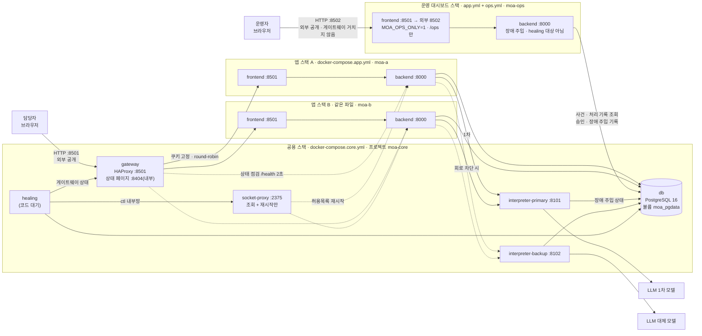

# MOA 시스템정의서 (D-03)

> 기술 스택 · 컨테이너 구성 · 배포 · 서비스별 시간 제한을 한 곳에 정한다.
> 코드 주석이 이 문서의 절 번호(1.2 · 1.5 · 2.1 · 2.2 · 3.1 · 4 · 7.1 · 7.2 등)를 가리킨다 — **절 번호를 바꾸지 않는다**(새 내용은 새 절 번호로 덧붙인다).

| 항목 | 내용 |
| --- | --- |
| 기준 시점 | 2026-11-06 · `main` (8e7c52c) — 운영 EC2 에 이 구성으로 배포됨 |
| 근거 | `docker-compose.core.yml` · `docker-compose.app.yml` · `gateway/haproxy.cfg` · `socket-proxy/haproxy.cfg` · `scripts/*.sh` · `backend/app/config.py` · `.github/workflows/ci.yml` |
| 확정 범위 | 스택 표(1절) · 구성도(2.1) · 컨테이너 목록(2.2) · 네트워크(2.3) · 시간 제한 중 구현 값(5.1) · 배포(7절) |

**다른 문서와의 경계** — 같은 값을 두 곳에 적지 않는다. 아래 항목은 정본 문서를 참조만 한다.

| 내용 | 정본 | 이 문서 |
| --- | --- | --- |
| 배포 구성 요구사항 · 장애 시나리오 · 복구 정책 수치 · 성공 기준 | [PRD](PRD.md) 5.4 · 8.1 · 8.4 · 9 | 그 요구를 **어떻게 구현했는가**(컨테이너 · 포트 · 네트워크 · 스크립트) |
| 에이전트 역할 · Handoff · 업무 층 상한 · 장애 대응 층 조건표 | [멀티 에이전트 아키텍처 설계서](멀티에이전트%20아키텍처%20설계서.md) 4 · 6 · 8 | 참조만 (3.2 · 5.2) |
| 일정 · 구현 분담 · 산출물 | [기획서](기획서.md) 6절 | 참조만 |
| 실행 · 배포 명령 | [README](../README.md) 실행 방법 · CI | 명령의 **이유와 순서 제약**(7.4) |

---

## 1. 기술 스택

### 1.1 스택 표 (확정)

| 영역 | 기술 · 버전 | 쓰는 곳 | 비고 |
| --- | --- | --- | --- |
| 언어 | Python 3.11 | backend · frontend · interpreter · healing | 이미지 `python:3.11-slim` |
| 화면 | **Streamlit 1.66.1** | `frontend/` — 담당자 화면 3개 + 운영 대시보드 | 1.60 이상 필요(`width="content"`) |
| API 서버 | **FastAPI 0.115.6** · uvicorn 0.34.0 | `backend/app/` — 에이전트 서버 | |
| 에이전트 흐름 | LangGraph 0.2.76 · langchain-core 0.3.86 | `backend/app/graph/` — 업무 층 노드 10개 | 장애 대응 층은 쓰지 않는다(1.2) |
| 주문 해석 서비스 | FastAPI (backend 와 같은 이미지) | `backend/interpreter/` — 1차 · 대체 2계통 | 3.1 · 4절 · PRD 5.5 |
| LLM | OpenAI (기본) · Anthropic · Ollama 선택 | `backend/app/llm.py` 한 곳에서 분기 | `LLM_PROVIDER` · 3.1 |
| 데이터베이스 | **PostgreSQL 16** (컨테이너) | 공용 스택 `db` · 스키마 `app` · `healing` | 드라이버 psycopg 3.2.3 · psycopg-pool 3.2.4 |
| HTTP 클라이언트 | httpx 0.28.1 | 화면 → 백엔드 · 백엔드 → 해석 서비스 · LLM | |
| 이미지 생성 | Pillow 11.0.0 + 나눔 글꼴 | 공유 카드 PNG — 메모리에서만 그린다(디스크 저장 없음) | 글꼴은 backend Dockerfile 이 설치 |
| 게이트웨이 | **HAProxy 3.2** (`haproxy:3.2-alpine`) | 공용 스택 `gateway` — 8501 하나로 앱 스택 A/B 분산 | 2.2 · 5.1 |
| Docker 제어 관문 | HAProxy 3.2 (같은 이미지) | 공용 스택 `socket-proxy` — 조회 + 허용목록 재시작만 | 2.3 · PRD 5.2 |
| 실행 · 배포 | **Docker Compose** — 공용 1벌 + 앱 2벌 | 로컬 · 시연 · EC2 같은 파일 | 2절 · 7절 |
| 이미지 저장소 | AWS ECR (ap-northeast-2) | `moa-backend` · `moa-frontend` | 커밋 sha 태그 + `latest` |
| 서버 | AWS EC2 **t3.small**(2GiB · x86/amd64) + 스왑 2GB · EBS 30GB | `~/moa` 에 compose · 설정 · 스크립트 · `.env` 만 둔다 | 소스 코드 없음 · 서버에서 빌드하지 않음 · 7.5 |
| CI/CD | GitHub Actions | 문서 외 변경 → 검사 · 테스트 → 이미지 빌드 → (main 만) 순차 배포 | 7.3 |

### 1.2 층 구분

| 층 | 구현 | 상태 |
| --- | --- | --- |
| 업무 층 | LangGraph 그래프 + 규칙. LLM 은 Intake · Menu · Review Agent 3곳 | 구현 |
| 장애 대응 층 (Monitor · Diagnosis · Recovery Worker · Verification) | 순수 Python 상태기계, **LLM 없음** | **컨테이너 자리만 있음** — 공용 스택 `healing`(`sleep infinity`) · socket-proxy · 연결 환경변수까지 배포됨. 코드가 들어오면 `command` 를 `python -m healing` 으로 바꾼다. `healing` 스키마(사건 · 회로 상태 · 장애 주입)와 운영 대시보드 조회는 구현 |

### 1.3 기획서 대비 바뀐 점

| 항목 | 처음 기획 | 확정 (이 문서) | 사유 |
| --- | --- | --- | --- |
| DB 위치 | PostgreSQL (Supabase) | `db` 컨테이너 PostgreSQL 16 | 결정 ⑬ · PRD FR-029. 원격 pooler 왕복 지연 · 장애 실험 통제 |
| LLM 제공자 | Anthropic 2계통 | OpenAI 기본, 제공자는 `.env` 로 전환 | 1차 · 대체를 서로 다른 모델로 둔다(3.1) |
| 컨테이너 | FE · BE 2개 | **10개** — 공용 6 + 앱 스택 A/B 각 2 (2.2) | 해석 서비스 2계통 · DB 컨테이너화 · 앱 이중화 · 게이트웨이 · Docker 제어 관문 |
| 외부 공개 | frontend 8501 | **gateway** 8501 | 앱 복제본 A/B 전환 (PRD 5.4 · SC-12) |

### 1.4 의존성 분리

Streamlit 1.66 은 `starlette>=0.46`, FastAPI 0.115.6 은 `starlette<0.42` 를 요구한다. **화면과 백엔드는 한 파이썬 환경에 같이 설치하지 않는다** — 컨테이너가 따로이고, 로컬도 `.venv` · `.venv-frontend` 두 개를 쓴다. 한 환경으로 합치려면 FastAPI 버전을 올려야 하며 이는 1.1 스택 변경이다.

### 1.5 로그

- 파일: 컨테이너 안 `/app/logs` (`LOG_DIR`) — `service.log` 전체 · `errors.log` ERROR 만 (해석 서비스는 `interpreter-<역할>.log`). 모든 줄에 `trace_id` · UTC 밀리초. event 이름은 고정 목록(`logging_setup.EVENTS`)
- **호스트에 남긴다**: `/app/logs` 를 서버 `~/moa/logs/<이름>/` 에 마운트한다 — `moa-a-backend` · `moa-b-backend` · `interpreter-primary` · `interpreter-backup` · `healing`. 배포가 컨테이너를 다시 만들어도 장애 실험의 로그 증빙이 남는다
- **보관 14일**: UTC 자정마다 `service.log.YYYY-MM-DD` 로 넘기고 14일치만 남긴다(PRD 9.3)
- 표준 출력에도 같은 줄을 쓴다(`docker logs`) — 크기 제한은 미결(8절 #6)

---

## 2. 시스템 구성

### 2.1 구성도 (확정)



- 화면은 백엔드 코드를 import 하지 않고 **HTTP 로만** 부른다(계약: D-02 API 스펙). 각 스택의 frontend 는 **같은 스택의 backend 만** 본다(2.3)
- 게이트웨이와 healing 은 서비스 이름이 아니라 **컨테이너 이름**(`moa-a-backend-1` 등)으로 대상을 지정한다 — 두 앱 네트워크에 다 붙어 있어 `backend` 라는 이름이 A · B 둘 다를 가리키기 때문이다
- 운영 대시보드 스택(`moa-ops`)은 게이트웨이 · healing 과 연결되지 않는다 — 앱 A · B 와 장애를 같이 겪지 않고, 늘 같은 backend 하나에 붙어 ops 토큰(backend 메모리)이 풀리지 않는다. 데이터는 공용 `db` 에서 읽는다(2.2 · 2.3)
- LLM 3곳(Intake · Menu · Review)은 모두 **해석 서비스 경계**를 지난다 — 5초 제한 · 계약 검증 · 대체 전환이 한 곳에서 걸린다

### 2.2 컨테이너 목록 (확정)

**12개** — 공용 스택 6 + 앱 스택 A/B 각 2 + 운영 대시보드 스택(moa-ops) 2. backend · interpreter 2계통 · healing 은 같은 이미지(`moa-backend`)를 쓰고 실행 명령만 다르다.

| 스택 | 컨테이너 | 이미지 | 역할 | 포트 | restart | healthcheck | 메모리 제한 |
| --- | --- | --- | --- | --- | --- | --- | --- |
| 공용 | `moa-core-gateway-1` | `haproxy:3.2-alpine` | A/B 분산 · 쿠키 고정 · 상태 점검으로 제외 · 재등록 | **8501 공개** (유일) · 8404 내부 | `unless-stopped` | — | 64m |
| 공용 | `moa-core-db-1` | `postgres:16` | 주문 · 메뉴 · 사건 기록 저장 | 5432 내부 | `unless-stopped` | `pg_isready` 5초 · 3초 · 10회 | 256m |
| 공용 | `moa-core-interpreter-primary-1` | `moa-backend` | 1차 주문 해석 (`INTERPRETER_ROLE=primary`) | 8101 내부 | **`"no"`** | — | 192m |
| 공용 | `moa-core-interpreter-backup-1` | `moa-backend` | 대체 주문 해석 (`INTERPRETER_ROLE=backup`) | 8102 내부 | `unless-stopped` | — | 192m |
| 공용 | `moa-core-socket-proxy-1` | `haproxy:3.2-alpine` | Docker API 관문 — 조회 + 허용목록 재시작만 | 2375 (`ctl` 내부망만) | `unless-stopped` | — | 32m |
| 공용 | `moa-core-healing-1` | `moa-backend` | 장애 대응 층 (지금은 자리만) | 없음 | `unless-stopped` | — | 192m |
| 앱 A · B | `moa-<a\|b>-backend-1` | `moa-backend` | 에이전트 서버 — API · LangGraph 업무 층 · 정산 | 8000 내부 | **`"no"`** | `/health` 5초 · 3초 · 5회 | 384m |
| 앱 A · B | `moa-<a\|b>-frontend-1` | `moa-frontend` | 담당자 화면 · 운영 대시보드 | 8501 내부 (게이트웨이만 들어옴) | `unless-stopped` | — | 256m |
| 운영 | `moa-ops-backend-1` | `moa-backend` | 운영 대시보드 전용 backend — 앱 스택과 같은 이미지, 장애 주입 · healing 대상 아님 | 8000 내부 | `unless-stopped` | `/health` 5초 · 3초 · 5회 | 384m |
| 운영 | `moa-ops-frontend-1` | `moa-frontend` | 운영 대시보드 진입 — A · B 가 함께 죽어도 장애 확인 · 복구 승인. `MOA_OPS_ONLY=1` 이라 어느 주소로 와도 `/ops`, 진입 게이트(G-0) 없이 운영 비밀번호 한 번 | **8502 공개** (게이트웨이 거치지 않음) | `unless-stopped` | — | 256m |

**restart 정책을 나눈 이유**

| 정책 | 대상 | 이유 |
| --- | --- | --- |
| `"no"` | backend(A · B) · interpreter-primary | 장애 주입 대상(F-1 · F-2 · F-3 · F-5). Docker 가 먼저 되살리면 탐지 · 복구 시간을 잴 수 없다(PRD R-14). 재시작은 healing Recovery Worker 몫이다 |
| `unless-stopped` | interpreter-backup | 대체가 살아 있어야 전환이 의미를 가진다(FR-016) |
| `unless-stopped` | frontend · gateway · socket-proxy · healing | 화면 · 진입점 · 복구 장치는 업무 처리와 따로 살아 있어야 한다 |
| `unless-stopped` | moa-ops backend · frontend | 운영 대시보드는 감시 대상(A · B)과 따로 늘 살아 있어야 한다. ops 토큰이 backend 메모리에만 있어 backend 하나에 고정해 붙는다 (`docker-compose.ops.yml`) |
| `unless-stopped` | db | 기반 저장소. F-6 은 DB 를 멈추지 않고 앱 안 `menu_store` 차단으로 주입한다 |

**메모리 제한** — 한 컨테이너가 같은 호스트의 다른 스택까지 죽이지 않게 하는 상한이다(예약이 아니다). 로컬 유휴 실측 합계 약 360MB(backend 약 60MB · frontend 약 46MB · interpreter 약 45MB · db 약 30MB · haproxy 약 12MB). 공유 카드 PNG 는 주문 묶음 수만큼 커져 아주 큰 주문에서 backend 메모리를 크게 쓸 수 있다(8절 #7).

**기동 순서**: 네트워크(2.3) → 공용 스택(`db` healthy → interpreter · gateway · socket-proxy · healing) → 앱 A → 앱 B → 운영 대시보드 스택(moa-ops, 실패해도 경고만). compose 의 `depends_on` 은 프로젝트를 넘지 못하므로 순서는 `scripts/deploy.sh` 가 지킨다. 게이트웨이는 앱 스택이 없어도 먼저 뜬다(`init-addr libc,none`).

### 2.3 네트워크 (확정)

| 네트워크 | 만드는 곳 | 붙는 컨테이너 | 이유 |
| --- | --- | --- | --- |
| `moa_core` | `scripts/init-networks.sh` (external) | gateway · db · interpreter 2 · healing · A/B backend | 공용 서비스. backend 는 여기서 db · interpreter 를 서비스 이름으로 찾는다 |
| `moa-a_default` · `moa-b_default` | `scripts/init-networks.sh` (external) | 각 스택 frontend · backend + gateway | 스택 격리 — frontend 는 자기 스택 네트워크에만 붙어 같은 스택 backend 만 보인다 |
| `moa-ops_default` | `scripts/init-networks.sh` (external) | moa-ops frontend · backend | 운영 대시보드 스택 전용. gateway 는 붙지 않는다 — 앱 A · B 와 장애를 같이 겪지 않게 |
| `moa-core_ctl` | compose (`internal: true`) | healing · socket-proxy 만 | Docker 제어는 healing 만 — backend 등에서 socket-proxy 가 보이지 않는다 |

- **미리 만드는 이유**: 앱 스택 네트워크를 compose 가 만들게 두면 앱 스택을 띄워야 생긴다. 게이트웨이(공용 스택)가 먼저 떠서 붙어야 하므로 이름은 PRD 5.4 그대로 두고 미리 만든다
- **socket-proxy 를 `moa_core` 에 두지 않는 이유**: PRD 5.4 · 기획서 6절은 "moa_core 전용"이라 적었으나, `moa_core` 에는 backend 도 있어 backend 가 Docker 재시작 API 에 닿는다. healing 만 닿는 내부망 `ctl` 로 좁혔다(PRD 9.3 보안 "광범위한 Docker 제어 권한을 주지 않는다")
- socket-proxy 통과 API: `GET /_ping` · `GET /containers/json` · `POST /containers/moa-(a|b)-(backend|frontend)-1/restart`. 나머지(inspect · stop · create · exec · delete · 이미지 등)는 403. inspect 는 응답에 환경변수(비밀값)가 담겨 막는다

---

## 3. 외부 의존

### 3.1 LLM

| 항목 | 값 |
| --- | --- |
| 제공자 분기 | `app/llm.py` 한 곳 (`LLM_PROVIDER` = `openai` · `anthropic` · `ollama`) |
| 1차 모델 | `LLM_MODEL` — interpreter-primary 가 쓴다 |
| 대체 모델 | `LLM_MODEL_BACKUP` — interpreter-backup 이 쓴다. **1차와 다른 계열**로 둔다(FR-016) |
| 해석 원천 | `INTERPRETER_SOURCE=llm`(기본) · `rules`(같은 입력 같은 결과 — 장애 실험 반복용). 루트 `.env` 로 정한다 |
| 추론 강도 | `LLM_REASONING_EFFORT=none` (실측 none 0.9초 · low 1.1초. 높이면 5초 제한에 다가간다) |

모델 이름 표기가 문서마다 다르다 — 8절 #2.

### 3.2 비용 · 폭주 상한

정본은 [설계서](멀티에이전트%20아키텍처%20설계서.md) 8.1 "비용 · 폭주 방어"와 `backend/app/config.py` 상수다(그래프 순회 25 · 되묻기 3 · 툴 왕복 3 · 재생성 2 · 분석 1회 LLM 호출 300 · Menu 20건 · Review 10건 · 묶음 1차 4 · 대체 2 · 병렬 4 · 입력 500건 · 1MB). 제공자 콘솔 지출 한도는 코드 밖에서 설정한다.

---

## 4. 주문 해석 서비스와 장애 주입

해석 서비스는 `healing.fault_injection` 행을 DB 에서 읽어 자기 모드를 정한다(대상 이름 `order_interpreter_primary` · `order_interpreter_backup`). 운영 대시보드 API-049 가 행을 쓴다.

| 모드 · 방법 | 동작 | 재현 장애 |
| --- | --- | --- |
| `error` | `/interpret` · `/health` 모두 503 | F-1 HTTP 5xx |
| `delay` | 6초 지연 후 응답 (제한 5초 초과) | F-2 타임아웃 |
| `invalid` | `event_type` 필드 제거 | F-5 잘못된 출력 |
| `scripts/fault.sh stop <a\|b> [backend\|frontend]` | 주입 시각을 `fault_injection`(F-3 · `agent_process` · `kill`)에 남기고 `docker stop` | F-3 앱 복제본 중단 |
| (`menu_store` 차단) | 앱 안에서 DB 조회 차단 | F-6 DB 조회 실패 |

- 회로 상태는 `healing.circuit_state` 에 있고, backend 의 그래프 노드가 이를 읽어 1차 / 대체 / 규칙 해석을 고른다. 재시도 · 전환 주체는 문서마다 다르게 적혀 있다 — 8절 #5
- **배포와 장애 주입**: `error` 모드에서는 interpreter `/health` 도 503 이다. `deploy.sh` 는 해석 서비스를 "HTTP 로 답하면 떠 있음"으로 판단한다(상태 코드 무관) — 주입이 켜져 있어도 배포가 멈추지 않는다(7.5 첫 배포 기록). backend `/health` 는 해석 서비스가 down 이어도 `degraded`(200)라 게이트웨이가 스택을 빼지 않는다(DEP-4)
- F-3 실험 회차에서 `fault.sh start` 를 쓰면 수동 개입 회차다(PRD 9.1)

---

## 5. 서비스별 시간 제한

### 5.1 구현된 값 (코드 기준)

| 구간 | 호출 주체 → 대상 | 제한 | 넘으면 | 정의 위치 |
| --- | --- | --- | --- | --- |
| 화면 읽기 요청 (GET) | frontend → backend | **10초** | 화면 오류 안내 | `frontend/api_client.py` `TIMEOUT` |
| 화면 쓰기 요청 (POST · PATCH 등) | frontend → backend | **30초** | 화면 오류 안내 | `frontend/api_client.py` `WRITE_TIMEOUT` — 실측 채팅 반영 11초. 짧으면 서버는 반영했는데 화면만 실패로 보여 중복 반영된다 |
| 주문 해석 호출 | backend → interpreter | **5초** | `DEP_TIMEOUT` (F-2) | `ORDER_INTERPRETER_TIMEOUT_SEC` (PRD 8.4) |
| LLM 호출 (해석 서비스 안) | interpreter → LLM | **5초** (연결 5초 이내) | 504 → `DEP_TIMEOUT` | 같은 값을 `llm.generate_structured(timeout=)` 에 넘긴다 |
| LLM 호출 (값 미지정 시 기본) | — | OpenAI · Anthropic 60초 · Ollama 120초 | `LLMError(timeout)` | `app/llm.py` `_timeout` |
| DB 연결 · 풀 대기 | backend → db | **2초** | `DB_UNAVAILABLE` (F-6) | `CONNECT_TIMEOUT_SEC` |
| DB 쿼리 | backend → db | **2초** (`statement_timeout`) | `DB_UNAVAILABLE`, 재시도 안 함 | `STATEMENT_TIMEOUT_MS` |
| DB 유휴 연결 정리 | backend 풀 | 240초 | 풀이 먼저 닫는다 | `db.py` `POOL_MAX_IDLE_SEC` |
| 상태 점검 — 해석 서비스 핑 | backend `/health` → interpreter | 0.8초 × 2 | `/health` degraded | `health.py` `_PING_TIMEOUT_SEC` |
| 컨테이너 healthcheck — backend | Docker → `/health` | 5초 간격 · **3초** 제한 · 5회 | `unhealthy` (frontend 미기동) | `docker-compose.app.yml` |
| 컨테이너 healthcheck — db | Docker → `pg_isready` | 5초 간격 · **3초** 제한 · 10회 | `unhealthy` | `docker-compose.core.yml` |
| **게이트웨이 상태 점검** | gateway → 같은 스택 backend `/health` | **2초 간격 · 3초 제한 · 2회 실패 제외 · 2회 성공 재등록** | 그 스택 MAINT/DOWN → 다른 스택으로 | `gateway/haproxy.cfg` `chk_a` · `chk_b` |
| 게이트웨이 → 화면 연결 | gateway → frontend | 연결 **1초** · 재시도 2회(매번 다른 스택) | 다른 스택으로 다시 보냄 | `haproxy.cfg` `timeout connect` · `redispatch 1` |
| 게이트웨이 WebSocket | 브라우저 ↔ frontend | **1시간** | 끊김 → 재접속 | `timeout tunnel` |
| 게이트웨이 DNS | Docker DNS | 1초 · 보류 2초 | 컨테이너가 멈추면 이름이 사라져 곧바로 제외 | `resolvers docker` |
| 체크포인트 정체 판정 | backend `/health` | **60초** | `/health` degraded (F-3 판정 근거) | `CHECKPOINT_STALE_SEC` |
| 진행 지연 안내 | 화면 | 15초 | "조금 더 걸리고 있어요" | `SLOW_NOTICE_SEC` |
| 장애 주입 지연 | interpreter `delay` 모드 | 6초 | 5초 제한 초과 유도 | `interpreter/main.py` `DELAY_SEC` |
| 배포 — 해석 서비스 기동 대기 | deploy.sh → interpreter | 2초 × 30회 = 60초 (응답만 확인) | 배포 실패 | `scripts/deploy.sh` `wait_http` |
| 배포 — 앱 스택 healthy · 게이트웨이 UP | deploy.sh | 180초 · 60초 | 배포 실패 · 다음 스택 교체 안 함 | `deploy.sh` `--wait-timeout` · `wait_gateway_up` |
| 배포 확인 | CI → EC2 `:8501` | 5초 × 30회 = 150초 | 배포 실패 | `ci.yml` |

**제한이 겹치는 관계** — 바깥 제한이 안쪽 제한보다 길어야 한다.

```
화면 쓰기 30초        >  backend 분석 1회 (묶음 병렬 × 해석 5초 + DB 2초 ...)
해석 호출 5초         ≥  LLM 호출 5초       (해석 서비스가 먼저 504 로 답한다)
healthcheck 3초       >  /health 안 핑 0.8초 × 2 + DB 조회
게이트웨이 점검 3초   >  /health 소요 (같은 이유) — 점검 간격 2초와 겹칠 수 있어 8절 #4
```

**측정 결과**(로컬 · `scripts/dep-test.sh`): A backend 중지 → 감지 3.5초 · 전환 4.0초, A frontend 중지 → 감지 3.5초 · 전환 3.9초, 재등록 1.8 ~ 2.6초. 순차 배포 중 요청 180건 모두 200.

### 5.2 장애 대응 층 정책 값

정본은 [PRD](PRD.md) 8.1(장애별 복구 정책) · 8.4(공통 정책 수치)와 [설계서](멀티에이전트%20아키텍처%20설계서.md) 8.2(장애 대응 층 조건표)다. healing 코드는 그 값을 쓴다. 배포 쪽이 정한 것은 F-3 재시작 수단뿐이다 — socket-proxy 의 허용목록 재시작(2.3), 다른 복제본이 게이트웨이에서 UP 인지(`GATEWAY_STATS_URL`) 확인한 뒤에만.

### 5.3 목표 지표

정본은 [PRD](PRD.md) 9절(SC-2 MTTD · SC-3 MTTR · SC-12 복제본 전환)이다. 배포 구성이 직접 책임지는 것은 SC-12(감지 · 전환 각 15초, 세션 복원 · 중복 0건)이며 `scripts/dep-test.sh` DEP-3 · DEP-5 로 잰다.

---

## 6. 데이터

| 스키마 | 내용 | 접속 롤 |
| --- | --- | --- |
| `app` | 세션 · 주문 항목 · 메뉴 · 공유 · 요청 이력 | `app_rw` (`APP_RW_PASSWORD`) |
| `healing` | 사건 · 회로 상태 · 장애 주입 등 7개 테이블 | `healing_rw` (`HEALING_RW_PASSWORD`) — healing R/W · app 읽기만 |

- `healing` 은 `app` 을 FK 로 참조하지 않는다 — `trace_id` 로 잇는다
- **DB 는 공용 스택에 하나**다. 앱 파일에 두면 프로젝트(moa-a · moa-b)마다 DB 가 따로 생겨 전환 뒤 세션 복원이 깨진다(TC-133 이 막는다)
- 볼륨 이름은 **`moa_pgdata` 로 고정** — 단일 compose 시절(프로젝트 `moa`) 볼륨을 그대로 이어 쓴다. 배포 때 "created for project moa" 경고는 이 때문이며 무해하다
- 초기화: `docker compose -f docker-compose.app.yml -p moa-a run --rm backend python sql/run_sql.py` (롤 → 스키마 → 뷰 → 시드. 14 데모 시드 제외). 새 서버 순서는 7.4
- **`docker compose down -v` 금지** — 주문 · 사건 기록이 지워진다. 백업은 없다(8절 #8)

---

## 7. 배포

### 7.1 환경 · 비밀값

| 파일 | 위치 | 내용 | 예시 |
| --- | --- | --- | --- |
| `.env` | 루트 (compose 치환용) | `POSTGRES_PASSWORD` · `HEALING_RW_PASSWORD` · (서버만) `REGISTRY`(끝 `/` 포함) · `TAG` · (선택) `INTERPRETER_SOURCE` | `.env.example` |
| `backend/.env` | backend | `LLM_*` · API 키 · `APP_RW_PASSWORD` · `HEALING_RW_PASSWORD` · `OPS_DASHBOARD_PASSWORD` | `backend/.env.example` |

- 비밀값은 `.env` 에만 둔다. 이미지에 넣지 않는다(`.dockerignore` · DEP-1 이 확인), git 에 올리지 않는다(`.gitignore`)
- **healing 에는 `backend/.env` 를 통째로 넘기지 않는다** — LLM 키 등 쓰지 않는 비밀값이 들어가므로 필요한 값(`DATABASE_URL`(healing_rw) · `DOCKER_HOST` · `GATEWAY_STATS_URL` · `HEALING_ALLOWLIST`)만 준다. 그래서 `HEALING_RW_PASSWORD` 가 루트 `.env` 에도 있어야 하며 `backend/.env` 와 같은 값이어야 한다(`scripts/server-check.sh` 가 확인)

### 7.2 포트 · 네트워크 보안

| # | 규칙 |
| --- | --- |
| 1 | 외부에 여는 포트는 **gateway 8501** 과 **운영 대시보드 8502**(`moa-ops-frontend-1`) 둘 (DEP-1 이 확인). 8502 도 8501 처럼 모두에게 연다(`0.0.0.0/0`) — 8501 의 [운영 대시보드] 버튼과 같은 비밀번호로 열리는 같은 화면이라 노출 범위가 늘지 않는다. 로그인 시도 제한이 없으므로 `OPS_DASHBOARD_PASSWORD` 는 12자 이상 |
| 2 | backend 8000 · frontend 8501 · interpreter 8101 · 8102 · db 5432 · 게이트웨이 상태 페이지 8404 · socket-proxy 2375 는 `expose` 만 (컨테이너 네트워크 안) |
| 3 | 로컬 개발은 `docker-compose.core.dev.yml`(db `127.0.0.1:5434` · 상태 페이지 `127.0.0.1:8404`) · `docker-compose.app.dev.yml`(A 8511/8001 · B 8512/8002) 덧씌우기로 **127.0.0.1 에만** 연다. DB의 5434는 로컬 5433 점유를 피하기 위한 개발 포트이며 배포에서 쓰지 않는다 |
| 4 | EC2 보안 그룹 22번은 운영자 IP 만. CI 러너 IP 는 배포 동안만 열고 끝나면 회수. 작업용으로 연 IP 도 끝나면 회수 |
| 5 | EC2 는 IAM 역할(`ec2-ecr-read`)로 ECR 을 읽는다 — 서버에 액세스 키를 두지 않는다 |
| 6 | `docker.sock` 은 socket-proxy 만 마운트한다(읽기 전용). healing 도 소켓에 직접 붙지 않는다 (2.3) |
| 7 | 게이트웨이 관리 명령 포트(9999)는 컨테이너 안 127.0.0.1 에만 — `deploy.sh` 가 `docker exec` 로만 쓴다 |

### 7.3 CI/CD

| 단계 | 트리거 | 내용 |
| --- | --- | --- |
| changes | main · dev push · 그쪽으로 향하는 PR | 바뀐 파일이 `docs/**` · `README.md` 뿐이면 이후 단계를 **건너뛴다(skipped)**. `backend/prompts/*.md` 는 코드로 본다. 판정 불가 · 실패면 전체 실행 |
| lint · test-backend · test-frontend | 문서 외 변경 | 정적 검사 · 일회용 PostgreSQL 에 스키마 적재 후 전체 흐름 테스트 · 화면 테스트. 셋 모두 룰셋 `dev-main-protect` 필수 검사(lint 는 PRD v1.2 9.2 에 따라 2026-11-06 추가) |
| build | 세 검사 통과 | backend · frontend 이미지 빌드. 룰셋 `dev-main-protect` 필수 검사(2026-11-06 추가) |
| deploy | **main push 만** | ECR push(sha + latest) → EC2 `~/moa` 에 compose · 게이트웨이 · 소켓 프록시 설정 · 스크립트 복사(tar) → `scripts/deploy.sh` 순차 교체 → 8501 확인. 실패하면 컨테이너 상태 · 게이트웨이 상태 · 로그를 남긴다 |
| report-failure | push 에서 실패 | GitHub Issue 생성 · 커밋 작성자 할당 |

- **필수 검사 때문에 `paths-ignore` 를 쓰지 않는다** — 워크플로가 아예 안 돌면 PR 이 "검사 대기"로 막힌다. 건너뛴(skipped) 잡은 통과로 인정된다
- **`scripts/deploy.sh` 순서**: `.env` 점검 → (처음 한 번) 옛 단일 스택(프로젝트 `moa`) 컨테이너 정리 → 네트워크 → 이미지 받기 → **healing 멈춤**(실패해도 끝날 때 다시 켬) → 공용 스택(설정은 HUP 으로 다시 읽음) → 해석 서비스 backup → primary **한 개씩** → **A 를 게이트웨이에서 먼저 빼고 교체 → healthy · UP 확인 → B** (A 가 UP 이 안 되면 B 는 건드리지 않는다) → healing 켬 → 옛 앱 이미지 정리(지금 버전 + 직전 1벌 보존, `KEEP_PREVIOUS`)

### 7.4 운영 절차 (새 절)

| 상황 | 할 일 | 이유 |
| --- | --- | --- |
| 새 서버 · 빈 DB | `sh scripts/init-networks.sh` → `docker compose -f docker-compose.core.yml -p moa-core pull` · `up -d db` → **이미지를 받은 뒤** `docker compose -f docker-compose.app.yml -p moa-a pull` · `run --rm backend python sql/run_sql.py` → `bash scripts/deploy.sh` | 초기화 전에는 backend 가 unhealthy 라 A 교체에서 멈춘다. 이미지가 없을 때 `run` 은 빌드를 시도하는데 서버에는 소스가 없어 실패한다 |
| 처음 배포 전 점검 | `bash scripts/server-check.sh` (읽기 전용) | 메모리 · 스왑 · compose 기능 · `.env` 키 · 옛 스택 · DB 볼륨 |
| **호스트 재부팅 · 인스턴스 중지 후 시작** | `bash scripts/deploy.sh` 한 번. 인스턴스를 멈췄다 켜면 **공개 IP 가 바뀐다**(Elastic IP 없음) → GitHub `EC2_HOST` 갱신 | `restart: "no"` 인 backend · interpreter-primary 는 자동으로 뜨지 않는다. healing 은 backend 만 재시작할 수 있고 interpreter-primary 는 허용목록 밖이다 |
| 이중화 배포 시험 | `bash scripts/dep-test.sh [--with-session] > dep-result.md` | DEP-1 ~ 5 결과표 · 실패 시 exit 1. 전제(공용 + A + B healthy) 미충족은 배포 구성 실패로 따로 보고(PRD 9.2) |
| F-3 장애 주입 | `bash scripts/fault.sh stop <a\|b>` · `status` · `clear` | 복구는 healing 몫 |
| 로그 보기 | `~/moa/logs/<컨테이너>/service.log` · `errors.log` | 1.5 |

### 7.5 서버 · 배포 기록 (새 절)

| 날짜 (UTC) | 내용 |
| --- | --- |
| 2026-11-05 | EC2 t2.micro(1GiB) → **t3.small**(2GiB). 컨테이너 10개 유휴만 약 360MB + OS · Docker. 공개 IP 변경(Elastic IP 없음) → GitHub `EC2_HOST` 갱신. 루트 `.env` 에 `HEALING_RW_PASSWORD` 추가 |
| 2026-11-05 07:50 | **첫 배포 실패 · 약 10분 중단** — 운영 DB 에 F-1 주입(error)이 켜져 interpreter-primary `/health` 가 503, `deploy.sh` 가 200 만 기다리다 실패. 옛 스택은 지운 뒤라 앱 스택 없이 끝나 8501 이 503. 앱 스택 A · B 를 수동으로 띄워 복구(데이터 그대로), `wait_http` 를 "응답만 확인"으로 고침(#92) |
| 2026-11-05 08:22 | 새 구성 첫 CI 무중단 배포 성공 (A 12초 → B 9초 교체) |
| 2026-11-05 09:19 | 옛 앱 이미지 10개 정리 · 디스크 21GB 남음, 로그 호스트 보존 시작(#98) |
| 2026-11-06 00:29 | **인스턴스 재시작 뒤 서비스 중단** — 공개 IP 변경(3.34.125.65 · `EC2_HOST` 갱신). `restart: "no"` 컨테이너(설계대로)와 함께 `unless-stopped` 인 gateway · socket-proxy 도 뜨지 않음. 원인: `deploy.sh` 가 설정을 다시 읽히려 보낸 `docker kill -s HUP` 을 Docker 가 "사람이 멈춤"으로 기록 → 자동 재시작 제외(로컬에서 재현 · 확인). 컨테이너 안 `kill -HUP 1` 로 바꿈 |

---

## 8. 미결 사항

| # | 항목 | 내용 | 결정 · 담당 |
| --- | --- | --- | --- |
| 1 | healing 실행 코드 | 자리 · 권한 · 연결 환경변수까지 배포됨. `command` 교체 · F-3 통합 시험 | healing 담당 |
| 2 | 1차 · 대체 모델 표기 불일치 | `backend/.env.example`: 1차 `gpt-4o-mini` · 대체 `gpt-5.4-mini` / [현황공유](멀티에이전트_현황공유.md) 3절 그림: 1차 `gpt-5.4-mini` · 대체 `gpt-4o-mini` | 배포 `.env` 기준으로 하나를 정해 맞춘다 |
| 3 | CI DB 버전 | CI 테스트 DB `postgres:15` · 운영 `postgres:16` | CI 수정 여부 |
| 4 | 게이트웨이 점검 경로 | PRD 5.4 대로 `/health` 를 쓴다. `/health` 는 DB · 해석 서비스 핑까지 해 최대 2초 가까이 걸려 2초 간격 점검과 겹칠 수 있다 — 가벼운 `/livez` 를 둘지 | 백엔드 담당 · PRD |
| 5 | **재시도 주체가 문서마다 다르다** | PRD 5.5 "호출하는 쪽은 재시도하지 않는다 · Recovery Worker 가 한다" · 이 문서 4절(구판) "backend 는 직접 재시도하지 않는다" ↔ [설계서](멀티에이전트%20아키텍처%20설계서.md) 8.1 · 코드(`nodes.intake_node`)는 업무 층이 **재생성 2회 + 대체 모델 1회 재요청**을 한다 | PRD · 설계서 중 하나로 정리 |
| 6 | Docker 표준 출력 로그 크기 | `docker logs`(json-file)에 크기 제한이 없다 — 게이트웨이 · 앱이 요청마다 남겨 디스크를 차지한다 | compose `logging: max-size` |
| 7 | 공유 카드 PNG 크기 상한 | 높이가 주문 묶음 수에 비례 — 아주 큰 주문에서 backend 메모리 제한(384m)에 다가갈 수 있다 | 백엔드 담당 |
| 8 | DB 백업 · ECR 정리 정책 | DB 는 EC2 볼륨 하나뿐(백업 없음). ECR 에 sha 태그 이미지가 쌓인다(정리 정책 없음) | 운영 결정 |
| 9 | 문서 간 배포 구성 서술 | PRD 5.4 · 기획서 6절의 socket-proxy 네트워크("moa_core 전용")가 구현(2.3 `ctl`)과 다르다. [현황공유](멀티에이전트_현황공유.md) 3절 그림은 단일 compose(컨테이너 5개 · frontend 8501 공개) 기준 | PRD · 기획서 · 현황공유 갱신 |
| 10 | 호출 제한 5초 재조정 (PRD U-09) | 실제 LLM 응답 실측 후 | 실측 결과로 5.1 갱신 |

---

## 변경 이력

| 버전 | 날짜 | 내용 |
| --- | --- | --- |
| v1.3 | 2026-11-05 | 문서 작성 — 스택 표 · 구성도 · 컨테이너 목록(5 + healing 예정) · 서비스별 시간 제한 확정. 단일 compose · config 기준 |
| v1.4 | 2026-11-06 | **배포 구성 개정** — 공용 스택 + 앱 스택 A/B(컨테이너 10) · HAProxy 게이트웨이 · socket-proxy · healing 자리 · 네트워크(2.3 신설) · 메모리 제한 · 로그 호스트 보존 14일 · 순차 배포 · 문서만 바뀌면 CI 건너뜀 · 운영 절차(7.4 신설) · 서버 · 배포 기록(7.5 신설). 다른 문서가 정본인 값(3.2 · 5.2 · 5.3)은 참조로 바꿈. 미결에 문서 간 불일치(#5 · #9) 추가 |
| v1.4 | 2026-11-06 | 7.3 CI/CD — lint · build 를 룰셋 `dev-main-protect` 필수 검사로 반영(lint 는 PRD v1.2 9.2) |
