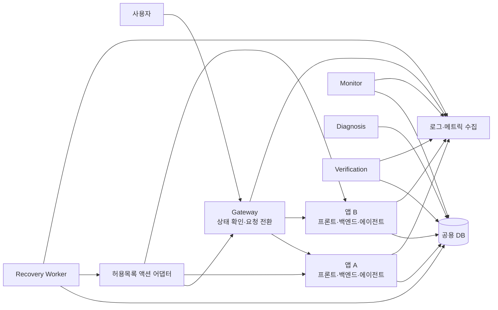
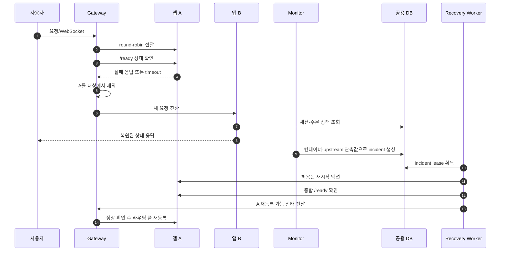
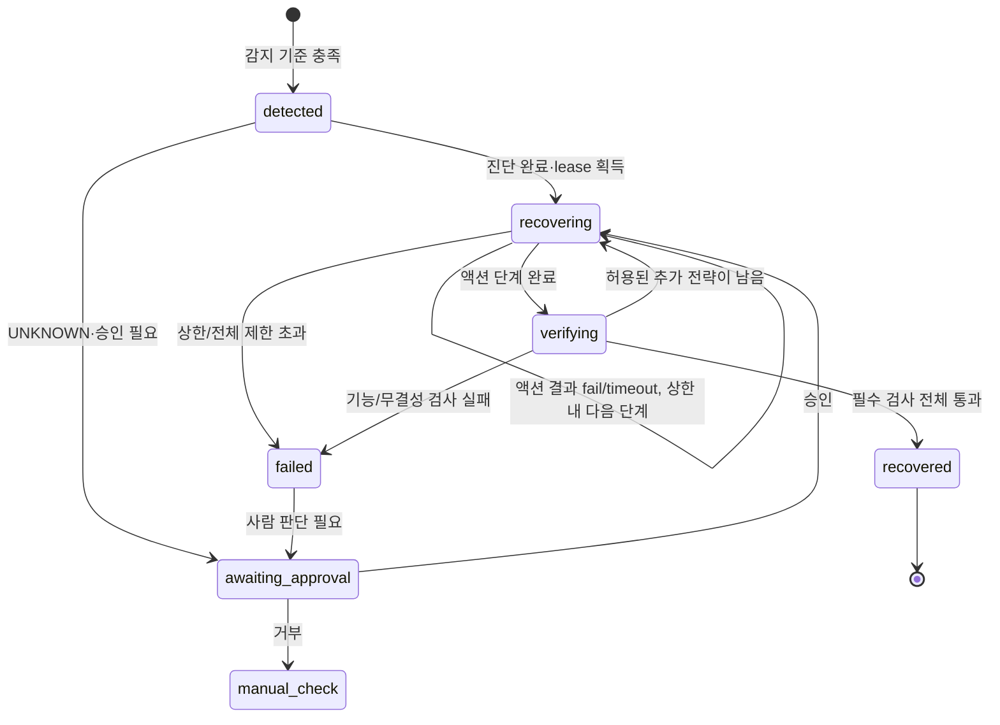
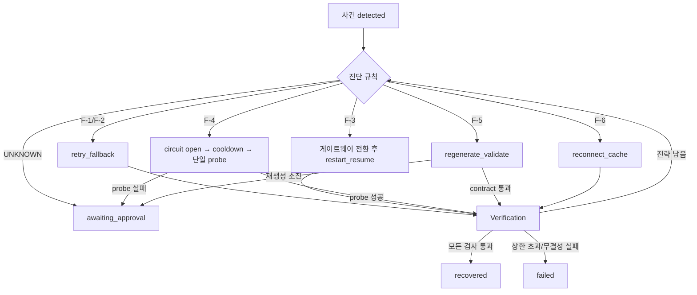

# 자동 복구 흐름 설계서

## 1. 목적과 적용 기준

이 문서는 [자동장애복구_계획서.md](자동장애복구_계획서.md)의 감지 메트릭·임계값·복구 상한을 실제 제어 흐름으로 풀어 설명한다. 두 앱 복제본의 요청 전환, 장애 사건 처리, 액션 실행, 독립 검증, 운영자 이관의 책임과 순서를 정의한다.

수치 기준은 자동장애복구 계획서를 단일 기준으로 사용한다. 이 문서에서는 같은 임계값 표를 반복하지 않고, 해당 기준에 따라 각 컴포넌트가 무엇을 하고 다음 단계로 어떤 정보를 전달하는지 설계한다.

현재 저장소에는 일부 기반 기능만 있고 전체 Monitor·Recovery 실행층은 아직 구현되지 않았다. 아래 흐름은 목표 설계이며, 완성된 동작으로 간주하지 않는다.

## 2. 구성요소와 책임

| 구성요소                      | 책임                                                                  |
| ----------------------------- | --------------------------------------------------------------------- |
| Gateway                       | 앱 A/B 상태 확인, 정상 앱에 요청 분산, 비정상 앱 제외·재등록         |
| 앱 복제본                     | 프론트·백엔드·에이전트 제공, 종합 준비 상태 보고, DB 기준 세션 복원 |
| Monitor / Diagnosis           | 관측값으로 사건을 만들고 고정 규칙에 따라 장애 유형 판정              |
| Recovery Worker / 액션 어댑터 | 사건 소유권·상한을 확인하고 허용된 복구 동작 실행                    |
| Verification                  | 복구 상태·기능·데이터 무결성 확인 및 최종 판정                      |
| 공용 DB                       | 업무 상태와 사건·시도·검증 결과 지속 저장                           |

## 3. 정상 요청 중 장애 전환 흐름

앱 복제본 하나의 장애는 Recovery보다 Gateway가 먼저 사용자 트래픽에서 격리한다. 이 빠른 격리와 뒤이은 자동 복구는 별도 단계다.

장애로 WebSocket이 끊기면 클라이언트는 세션 식별 정보로 재접속하고, 새 앱은 DB에서 주문·진행 상태를 복원한다. Gateway 전환은 요청 경로 복구이며, 업무 데이터 복구나 이미 실패한 요청의 재처리를 의미하지 않는다. 재시작된 앱은 내부 필수 프로세스가 모두 준비된 뒤 라우팅 풀에 복귀한다.

## 4. 장애 사건의 공통 처리 상태도

상태 변경은 healing DB 트랜잭션에서 기록한다. `recovered`는 Verification만 설정할 수 있다. 승인 API는 운영자 결정을 기록하고 상태만 전환하며, 액션은 Recovery Worker가 실행한다. 거부된 사건은 `manual_check`로 끝내고, 실패·승인 대기 중에는 자동 조치를 재개하지 않는다.

## 5. Monitor → Diagnosis → Recovery → Verification 상세

### 5.1 Monitor

1. 계획서에 정의된 수집 주기대로 네트워크·컨테이너·DB·API·LLM·프롬프트 관측값을 읽는다.
2. 요청 오류, health probe 실패, 컨테이너 종료 같은 관측값을 `replica_id`, dependency, route group, provider/task, prompt version으로 구분한다.
3. 임계값을 넘으면 fault code 후보와 증거를 만든다. 비율 경보는 최소 표본 조건을 만족할 때만 사용한다.
4. 같은 대상·원인의 미종료 사건이 있으면 사건을 새로 만들지 않고 증거·마지막 관측 시각을 갱신한다.
5. 새 사건 생성 시 `injected_at`(실습 주입 사건에만), `detected_at`, `detection_metric`, `detection_evidence`, `trace_id`를 함께 기록한다.

오탐 판정이나 계획서 임계값 변경은 Monitor가 하지 않는다. 장애가 아니라고 확인되면 사건을 false positive로 표시하고 이유를 남긴다.

### 5.2 Diagnosis

Diagnosis는 관측 이벤트를 허용된 fault code와 전략에 연결하는 결정표다.

| 증거                                                     | fault code                         |
| -------------------------------------------------------- | ---------------------------------- |
| 앱 `/ready` 실패 또는 컨테이너 종료, 다른 앱은 healthy | `WORKER_DOWN`                    |
| 해석기 HTTP 5xx 또는 timeout                             | `DEP_HTTP_5XX` / `DEP_TIMEOUT` |
| 동일 의존성의 반복 실패                                  | `REPEATED_FAILURE`               |
| 구조화 출력 contract 검증 실패                           | `AGENT_OUTPUT_INVALID`           |
| 메뉴 DB 조회 실패                                        | `DB_UNAVAILABLE`                 |
| 모호하거나 미등록된 장애 증거                            | `UNKNOWN`                        |

동일 incident에는 가장 구체적인 원인을 우선하고, 원인이 바뀌면 이전 판정을 덮어쓰지 않고 재진단 기록을 추가한다. 진단 결과에는 선택 이유, 증거 참조, 전략, 전략 상한을 포함한다.

### 5.3 Recovery Worker 소유권과 실행

1. `detected` 사건을 DB에서 가져와 row lock 또는 lease를 획득한다. 동시에 두 Worker가 같은 사건을 실행할 수 없다.
2. 사건 상태·시도 횟수·전략 재실행 제한·전체 제한 시간을 확인한다.
3. `recovery_started`를 기록한 다음 허용된 Python 액션 함수만 호출한다.
4. 액션 직전과 직후를 `recovery_attempt`에 기록한다. 기록 실패 시 액션을 실행하지 않는다.
5. 결과가 불명확한 timeout은 실패로 간주하고 무조건 반복하지 않는다. 재시도 가능 여부는 액션의 멱등성 규칙으로 판단한다.
6. 모든 액션 단계가 완료되면 `verifying`으로 넘기고, 액션 상한을 넘으면 `failed` 또는 `awaiting_approval`로 보낸다.

Worker가 죽으면 lease 만료 후 다른 Worker가 사건을 이어받는다. 이어받은 Worker는 DB 시도 기록과 액션 키를 확인해 이미 완료된 동작을 반복하지 않는다.

### 5.4 Verification

검증은 조치 실행과 독립된 모듈에서 수행한다. 공통 검사는 연속 health 정상, 기능 샘플, 데이터 무결성이다. F-1은 검증 요청 5건, F-3은 체크포인트와 변경 보존, F-6은 캐시·DB 결과 일치 검사를 추가한다.

각 검사 결과를 `verification_result`에 저장한다. 한 검사라도 실패하면 복구 성공으로 처리하지 않는다. 더 수행할 수 있는 안전한 전략이 남아 있으면 Recovery로 돌려보내고, 없으면 `failed` 또는 승인 대기로 끝낸다.

## 6. 장애 유형별 제어 흐름

장애 유형별 액션은 이 흐름도에만 표시하고, 재시도·대기·상한은 자동장애복구 계획서를 따른다.

## 7. 저장 데이터와 로그 연결

| 흐름 단계  | 저장소/이벤트                           | 최소 연결 키                                                   |
| ---------- | --------------------------------------- | -------------------------------------------------------------- |
| 주입       | `healing.fault_injection`             | injection ID, fault, target, injected_at                       |
| 감지·진단 | `healing.incident`                    | incident ID, trace ID, fault code, metric/evidence, strategy   |
| 액션       | `healing.recovery_attempt`            | incident ID, attempt number, action, target, result, start/end |
| 회로       | `healing.circuit_state`               | dependency key, state, failure streak, cooldown, active route  |
| 검증       | `healing.verification_result`         | incident ID, check name, expected/actual summary, pass/fail    |
| 승인       | `healing.approval`                    | incident ID, decision, approver, waiting time                  |
| 종합 관측  | `healing.runtime_metric` 및 JSON 로그 | replica/service, metric key, measured_at, trace/incident ID    |

로그 공통 필드·수집 원천·보존·민감정보 제외 기준은 자동장애복구 계획서 4절을 따른다. 모든 이벤트는 `incident_id`로 사건 타임라인, `trace_id`로 업무 요청에 연결한다. 로그 수집 실패가 업무 처리나 복구 액션의 완료 판정을 대신하지 않도록 한다.

## 8. 안전 규칙과 실패 처리

- DB와 healing 상태가 불명확하면 복구 성공을 선언하지 않는다. 업무 데이터 수정·삭제, 완료된 주문서 덮어쓰기, 미등록 메뉴 자동 확정은 복구 액션에서 금지한다.
- 재시도는 read-only 또는 idempotency key로 중복을 막는 작업에만 한다. 요청 결과가 불명확한 쓰기 작업은 상태를 먼저 조회한다.
- F-6 캐시는 해당 세션의 `menu_version`과 일치할 때 읽기 전용으로 쓴다. 캐시가 없거나 일치하지 않으면 추측하지 않고 안전하게 중단한다.
- 승인 대기 상태에서는 사람의 결정 전까지 설정 변경·probe 반복·무제한 재시도를 하지 않는다.
- 게이트웨이·DB·호스트 장애는 앱 복제본 복구율에 섞지 않고 별도 범위로 보고한다.

## 9. 설계 완료 확인

흐름 구현을 완료했다고 판정하려면 아래 증거가 모두 있어야 한다.

1. Monitor가 정의된 metric을 사건으로 만들고 같은 장애를 중복 사건으로 만들지 않는다.
2. Diagnosis가 고정된 규칙과 증거를 저장하며 `UNKNOWN`은 승인 대기로 보낸다.
3. Recovery Worker가 lease·상한·액션 목록을 지키고, 재시작 후에도 실행 중 사건을 안전하게 이어받는다.
4. Gateway가 앱 A/B 장애 전환 및 readiness 후 재등록을 수행하고 로그에 대상 replica가 남는다.
5. Verification이 유형별 검사와 데이터 무결성을 실행하며 성공 전에는 `recovered`로 바꾸지 않는다.
6. F-1·F-2·F-3·F-5·F-6의 반복 시험 결과, 무인 성공률, MTTD/MTTR, 중복·유실 결과가 자동장애복구 계획서 7절 표에 기록된다.
