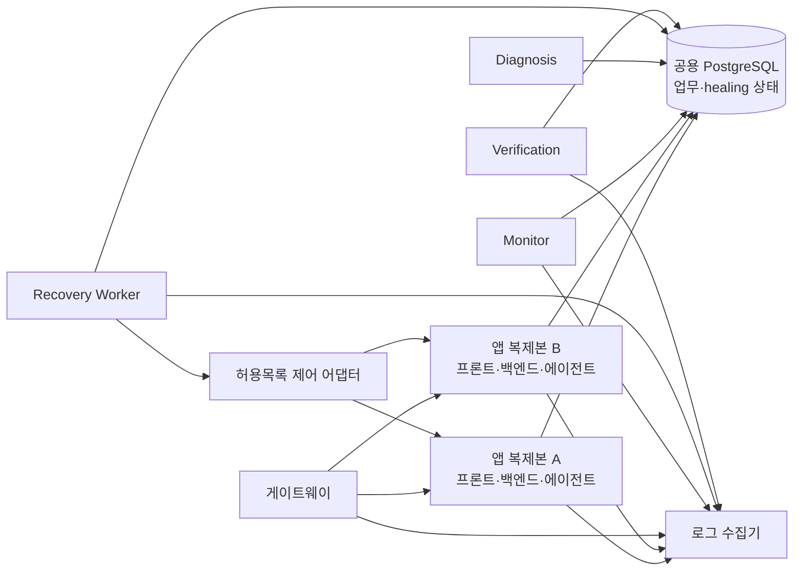

# 자동 장애 복구 계획서

배포 및 장애 복구 보고서

## 1. 목적과 기준 문서

이 계획서는 `기획서.md`의 장애 복구 보고 요구사항과 `PRD.md` 8·9절의 F-1~F-6 정책·SC-1~SC-6 성공 기준을 구현·측정 계획으로 연결한다. 자동 복구, 두 앱 컨테이너의 전환, 로그·메트릭, 시험과 성공률을 이 문서 하나에서 다룬다.

목표는 사전 허용된 복구 동작을 자동으로 실행하고, 실패하거나 안전한 판단이 불가능하면 멈춰 운영자에게 넘기는 것이다. 성공 여부는 기능이 있다는 설명만으로 판정하지 않고 장애 시험 결과와 로그로 입증한다.

## 2. 목표 구성



- 앱 A·B는 동일한 버전으로 요청을 처리한다. 게이트웨이는 상태가 나쁜 복제본을 먼저 제외해 사용자 요청을 정상 복제본에 전달한다.
- Monitor·Diagnosis·Recovery·Verification은 업무 요청 처리와 분리된 `healing` 서비스로 둔다. 이 서비스는 업무 데이터를 직접 고치지 않고, 사전 허용된 조치만 호출한다.
- 두 복제본은 세션·주문·회로 상태를 공용 DB에서 읽는다. 로컬 메모리 캐시는 `menu_version`으로 구분하고, 캐시만으로 불확실한 메뉴를 확정하지 않는다.
- Recovery Worker가 둘 이상 실행되더라도 같은 사건의 조치를 중복 실행하지 않도록 DB 임대(lease) 또는 advisory lock으로 한 실행자만 소유하게 한다.
- 컨테이너 제어는 고정된 복제본 이름과 `restart`, `health`, `ready` 같은 동작만 허용하는 제한 어댑터를 통한다. Worker에 임의 셸 명령이나 광범위한 Docker 제어 권한을 주지 않는다.
- 게이트웨이·DB·실행 호스트 자체의 복구는 이 계획의 앱 복제본 장애 성공률과 분리해 기록한다.

### 2.1 Compose 배포 매니페스트 명세

배포 기준 파일은 `docker-compose.ha.yml`로 정하고, 개발용 `docker-compose.dev.yml`과 분리한다. 아래는 작성할 매니페스트의 서비스·네트워크·시크릿 계약이다. 앱 이미지를 묶는 실행기와 게이트웨이 설정이 준비되기 전에는 실행 가능한 배포 파일로 간주하지 않는다.

| 서비스               | 수량 | 네트워크/포트                               | 역할·의존성                                                                                  |
| -------------------- | ---: | ------------------------------------------- | --------------------------------------------------------------------------------------------- |
| `gateway`          |    1 | 외부 `8501`만 공개, `moa_internal` 연결 | WebSocket 전달, `/ready` 활성 확인, round-robin, unhealthy 대상 제외                        |
| `app-a`, `app-b` | 각 1 | `moa_internal` 전용, 외부 포트 없음       | 동일 이미지·버전. 각 컨테이너에 Streamlit·FastAPI·주문 해석 에이전트와 종합 준비 확인 실행 |
| `db`               |    1 | `moa_internal` 전용, 영속 `pgdata` 볼륨 | 두 앱과 Recovery가 공유하는 주문·사건 상태 저장소                                            |
| `healing`          |    1 | `moa_internal` 전용, 외부 포트 없음       | Monitor·Diagnosis·Recovery·Verification 실행. 같은 사건은 lease로 한 번만 소유             |

Compose 매니페스트의 핵심 형식은 다음과 같다. 비밀값은 리터럴로 쓰지 않고 저장소에서 제외한 루트 `.env`에서 필요한 서비스에만 주입한다.

```yaml
services:
  gateway:
    image: haproxy:PINNED_VERSION
    ports: ["8501:8501"]
    volumes:
      - ./deploy/haproxy.cfg:/usr/local/etc/haproxy/haproxy.cfg:ro
    networks: [moa_internal]
    depends_on: [app-a, app-b]
    restart: unless-stopped

  app-a: &moa_app
    image: ${MOA_APP_IMAGE:?set MOA_APP_IMAGE}
    expose: ["8501"]
    environment: &moa_app_env
      REPLICA_ID: app-a
      DATABASE_URL: postgresql://postgres:${POSTGRES_PASSWORD:?set POSTGRES_PASSWORD in .env}@db:5432/postgres
      OPENAI_API_KEY: ${OPENAI_API_KEY:-}
      OPS_DASHBOARD_PASSWORD: ${OPS_DASHBOARD_PASSWORD:?set OPS_DASHBOARD_PASSWORD}
      BACKEND_URL: http://127.0.0.1:8000
      ORDER_INTERPRETER_PRIMARY_URL: http://127.0.0.1:8101
      ORDER_INTERPRETER_BACKUP_URL: http://127.0.0.1:8102
    networks: [moa_internal]
    depends_on:
      db:
        condition: service_healthy
    restart: "no"
    healthcheck:
      test: ["CMD", "python", "-c", "import urllib.request; urllib.request.urlopen('http://127.0.0.1:8501/ready', timeout=2)"]
      interval: 5s
      timeout: 5s
      retries: 3

  app-b:
    <<: *moa_app
    environment:
      <<: *moa_app_env
      REPLICA_ID: app-b

  db:
    image: postgres:16
    environment:
      POSTGRES_DB: postgres
      POSTGRES_PASSWORD: ${POSTGRES_PASSWORD:?set POSTGRES_PASSWORD in .env}
    volumes: [pgdata:/var/lib/postgresql/data]
    networks: [moa_internal]
    restart: unless-stopped

  healing:
    image: ${MOA_APP_IMAGE:?set MOA_APP_IMAGE}
    command: ["python", "-m", "app.healing.worker"]
    environment:
      DATABASE_URL: postgresql://postgres:${POSTGRES_PASSWORD:?set POSTGRES_PASSWORD in .env}@db:5432/postgres
      ENVIRONMENT: lab
    networks: [moa_internal]
    depends_on:
      db:
        condition: service_healthy

networks:
  moa_internal:
    driver: bridge

volumes:
  pgdata:
```

앵커 예시의 `REPLICA_ID` 외 설정은 실제 합본 이미지의 내부 포트·프로세스 구성에 맞춰 확정한다. 앱 컨테이너 내부에서 프론트는 같은 컨테이너의 백엔드 API를 호출하고, 게이트웨이는 외부 요청을 앱의 프론트 진입점으로 전달한다. 한 내부 구성요소가 준비되지 않으면 앱의 `/ready`는 성공을 반환하지 않는다.

### 2.2 서비스 탐색·로드밸런싱·시크릿 기준

- **서비스 탐색:** `gateway`와 `app-a`/`app-b`는 `moa_internal` 네트워크의 Compose 서비스 DNS 이름으로 서로를 찾는다. 고정 컨테이너 IP는 쓰지 않는다. 게이트웨이는 Docker DNS를 10초 이하 간격으로 갱신해 컨테이너 재생성 뒤 새 주소를 따라간다.
- **분산:** HAProxy backend는 `balance roundrobin`으로 정상 앱에 요청을 분배한다. `/ready`를 2초 간격으로 확인하고 2회 실패하면 해당 앱을 제외, 2회 연속 성공하면 다시 포함한다. WebSocket은 쿠키 기반 고정 연결을 유지하며 장애 후 재연결은 다른 정상 앱으로 허용한다.
- **화면 상태:** Streamlit의 메모리 상태만으로 복구하지 않는다. 세션 토큰·세션 ID를 이용해 DB/API에서 주문·진행 상태를 다시 불러오고, 복구할 수 없는 일시 UI 상태는 사용자 입력으로 재구성할 수 있게 한다.
- **시크릿 출처:** PRD에 따라 비밀값 원본은 루트 `.env` 한 곳으로 제한하고 Git에 커밋하지 않는다. Compose에는 `${VAR:?}` 형태의 필수값 참조만 둔다. 각 서비스에는 필요한 변수만 주입하고, 이미지·명령행 인자·로그·오류 응답·보고서에는 비밀값을 넣지 않는다.
- **시크릿 보호:** `.env` 파일의 로컬 접근 권한을 제한하고 교체 시 두 앱과 DB/해당 소비자를 함께 재기동한다. `docker compose config` 출력은 비밀값이 확장될 수 있으므로 저장·공유하지 않는다. 시크릿 노출 검사 결과는 노출 건수만 기록한다.
- **공용 데이터:** A·B는 동일한 `DATABASE_URL`과 DB 볼륨을 쓴다. DB는 이 앱 다중화 범위에서 단일 서비스이므로 DB 복제본이나 앱별 DB를 만들지 않는다.

게이트웨이 예시 설정의 핵심은 다음과 같다. 파일은 `deploy/haproxy.cfg`로 매니페스트와 함께 작성한다.

```haproxy
global
  log stdout format raw local0

defaults
  mode http
  log global
  option httplog
  timeout connect 2s
  timeout client 60s
  timeout server 60s

frontend moa_public
  bind *:8501
  default_backend moa_apps

backend moa_apps
  balance roundrobin
  cookie APPNODE insert indirect nocache
  option httpchk GET /ready
  http-check expect status 200
  server app-a app-a:8501 check inter 2s fall 2 rise 2 cookie a resolvers docker init-addr libc,none
  server app-b app-b:8501 check inter 2s fall 2 rise 2 cookie b resolvers docker init-addr libc,none

resolvers docker
  nameserver dockerdns 127.0.0.11:53
  resolve_retries 3
  timeout resolve 1s
  hold valid 10s
```

HAProxy 설정은 Compose DNS 변경을 따라가도록 resolver를 포함한다. 게이트웨이 단일 장애는 이번 시험 범위에서 제외하지만, 앱 A/B 어느 하나의 장애는 15초 안에 다른 복제본으로 넘기는 것을 목표로 한다.

## 3. 전체 자동 복구 흐름

1. **수집:** 게이트웨이 상태 확인, API 응답, DB 연결·쿼리, 해석기 응답, 컨테이너 상태와 LLM 계약 검증 결과를 기록한다.
2. **감지:** Monitor가 5초 간격으로 상태를 평가한다. 단일 일시 오류는 사건으로 만들지 않고, PRD 기준상 2회 연속 실패를 장애로 판정한다. 실제 측정 MTTD 목표는 15초 이하다.
3. **중복 방지:** 장애 대상·코드별로 열린 사건을 찾아 기존 사건에 증거를 추가한다. 이미 복구 중인 사건에는 같은 복구 작업을 다시 enqueue하지 않는다.
4. **진단:** 고정된 규칙으로 fault code와 전략을 선택한다. LLM은 진단 명령이나 컨테이너 조치를 만들지 않는다. `UNKNOWN`은 자동 실행하지 않고 승인 대기로 보낸다.
5. **복구:** Recovery Worker가 DB에 실행 횟수와 시도를 먼저 기록하고 허용목록 액션을 수행한다. 각 재시도와 전체 사건에는 상한을 둔다.
6. **검증:** Verification이 3회 연속 정상 상태, 시나리오별 기능 검사와 데이터 무결성을 확인한다. F-1 성공 기준은 검증 요청 5건 실패 없음이다.
7. **종료 또는 에스컬레이션:** 모든 필수 검증을 통과하면 `recovered`; 상한 초과·검증 실패는 `failed`; 사람 판단이 필요한 사유는 `awaiting_approval`로 남긴다. 승인 거부는 `manual_check`로 보낸다.
8. **보고:** 사건 타임라인, 복구 시도, 검증 결과와 로그 링크를 운영 화면에서 `incident_id`로 조회하게 한다.

상태 흐름:

```text
감지 → 진단 → 복구 중 → 검증 → 복구 성공
                 ├────→ 복구 실패
                 └────→ 승인 대기 → 승인: 복구 중 / 거부: 수동 점검
```

## 4. 수집 로그와 메트릭

### 4.1 공통 필드

모든 JSON 로그는 UTC 밀리초 시각을 쓰고 가능한 경우 다음 필드를 포함한다.

`ts`, `level`, `event`, `service`, `replica_id`, `trace_id`, `incident_id`, `session_id`(내부 ID만), `fault_code`, `duration_ms`, `result`, `error_code`.

`incident_id`는 사건 중심 상관 키이고 `trace_id`는 요청 중심 상관 키다. 컨테이너 이름만으로 사건을 연결하지 않는다. 세션 토큰, Authorization 헤더, 비밀번호, API 키, 원문 대화, 프롬프트 전문, SQL 바인딩 값, 사용자 개인정보는 로그에 남기지 않는다.

### 4.2 로그 종류

| 원천             | 수집할 이벤트·필드                                                                                                      | 사용 목적                                                     |
| ---------------- | ------------------------------------------------------------------------------------------------------------------------ | ------------------------------------------------------------- |
| 게이트웨이       | 요청 경로 템플릿, 선택된 `replica_id`, upstream 상태 코드·지연, health 제외/재등록, WebSocket 종료                    | 분산 확인, 장애 감지·전환시간 측정                           |
| 컨테이너 런타임  | 컨테이너 ID/복제본, 이미지 digest, 시작·종료·비정상 종료 시각, exit code, 상태 확인 결과, 재시작 횟수                  | F-3 재시작 및 재가입 감사                                     |
| 백엔드 API       | `request` 이벤트, method, route template, status, duration, retryable/error code, `trace_id`                         | API 오류율·지연, 영향 요청 추적                              |
| 네트워크·해석기 | 대상 서비스, connect/read timeout, HTTP 5xx 비율, latency, 선택된 primary/backup 경로, 회로 상태 전이                    | F-1/F-2 감지와 대체 전환 근거                                 |
| DB               | 연결 실패, 연결 재시도, pool 대기·사용률, query p95, statement timeout, reconnect 결과, 캐시 사용 여부                  | F-6 감지·복구 및 DB 병목 확인                                |
| LLM·에이전트    | provider/model 식별자, task, 호출 지연, 5xx/timeout, schema valid, missing field 수, 재생성 횟수, 토큰 사용량(제공될 때) | LLM 장애·계약 위반 감지 및 비용 상한 추적                    |
| 프롬프트         | prompt version/hash, task, 형식 검증 결과, 재생성 결과, 해당 버전의 오류율                                               | 잘못된 프롬프트/출력 회귀 식별. 프롬프트 원문은 저장하지 않음 |
| 복구 Worker      | 사건 상태 전이, diagnosis rule, 전략, 시도 번호, action, allowlist target, 대기 시간, 성공/실패/timeout, 에러 코드       | 자동 조치 감사 및 재실행 방지 확인                            |
| Verification     | 검사명, 기대값, 실제 요약값, pass/fail, 연속 정상 횟수, 샘플 요청 성공 수, 데이터 무결성 결과                            | 성공 판정 및 MTTR 종료 시각                                   |

### 4.3 메트릭 목록과 임계값

기준은 PRD의 확정 수치를 우선한다. PRD가 비율 기준을 주지 않은 API·LLM·프롬프트 추세 경보는 이 계획서의 초기 운영 기준으로 아래처럼 정한다. 개별 요청에 대한 PRD의 timeout·재생성·회로 차단 규칙은 비율 경보를 기다리지 않고 즉시 적용한다.

| 유형                | 수집 메트릭·원천                                                                                                              | 평가 구간·확정 임계값                                                                                                                                                                                                                                                              | 감지 후 동작과 검증                                                                                                                          |
| ------------------- | ------------------------------------------------------------------------------------------------------------------------------ | ----------------------------------------------------------------------------------------------------------------------------------------------------------------------------------------------------------------------------------------------------------------------------------- | -------------------------------------------------------------------------------------------------------------------------------------------- |
| 컨테이너·네트워크  | 앱 종합 `ready`, 게이트웨이 upstream 연결 실패·상태 확인 지연, 컨테이너 exit code/재시작 횟수                               | 상태 확인 5초 간격, 2회 연속 실패 시 장애, MTTD ≤15초 (PRD)                                                                                                                                                                                                                        | 게이트웨이가 해당 복제본을 제외하고 다른 복제본으로 전달. F-3 허용 대상 재시작 후 종합 준비 상태 확인                                        |
| DB                  | 연결 실패 횟수·지연, 풀 대기/사용률, 쿼리 p95·statement timeout; DB 드라이버 및 `runtime_metric`                           | connect/query 제한 2초, 재연결 3회, 1·2·4초 간격은 PRD의 평가 가안. 연결 실패 2회 연속 시 사건. 풀 사용률 **≥80%**가 연속 2개의 1분 구간에서 관측되면 용량 경보                                                                                                                  | F-6 재연결·풀 재생성 후 `menu_version` 일치 캐시로 읽기 폴백. DB 복귀 뒤 캐시와 DB 결과 비교                                              |
| API                 | route group별 요청 수·상태 코드·5xx·p95; 게이트웨이 및 백엔드 `request` 로그                                              | 5xx 비율 **≥10%**, 최근 5분·최소 20요청; 또는 같은 route group에서 **5xx 2회 연속**. p95 지연은 정상 기준선의 **2배 초과**가 2개의 연속 1분 구간에서 발생하고 각 구간 20요청 이상일 때 경보. 4xx 제외                                                           | 5xx 연속 실패가 upstream이면 PRD의 5초 timeout·재시도·대체 경로 정책 적용. p95 경보는 서비스 저하 사건 생성. `trace_id`로 영향 요청 연결 |
| LLM·에이전트       | task/provider/model별 호출 수, timeout·5xx·429, latency, schema 통과 여부, 재생성 횟수, 토큰 수; `llm_history`와 호출 로그 | 호출 timeout **5초** (PRD; 실 LLM은 운영 적용 전 조정), timeout·5xx 실패율 **≥10%**, 최근 5분·최소 20호출; 또는 같은 provider/task에서 timeout·5xx **2회 연속**. 429는 실패율에서 분리하고 **최근 5분 중 20호출 이상에서 10% 이상**이면 rate-limit 경보 | F-1/F-2 복구 정책은 5절 적용. 429 경보는 추가 호출을 늘리지 않고 해당 provider 호출을 제한                                                   |
| 프롬프트·출력 계약 | `prompt_version`/hash·task별 필수 필드 누락 수, schema 실패 수, 재생성 후 실패 수; 프롬프트 원문은 수집하지 않음            | 개별 출력은 형식 실패 시 동일 입력 재생성 최대 2회 (최초 포함 총 3회, PRD). 버전별 추세 경보는 최근 **20개 출력 중 4개 이상 실패(20%)**. 한 요청에서 재생성 소진은 표본 조건과 무관하게 즉시 사건                                                                             | 통과 출력만 전달. 소진된 출력은 `needs_review`로 중단. 추세 경보만으로 prompt를 변경하지 않으며 버전 교체·롤백은 승인 필요                |

#### 임계값 계산·적용 원칙

- 메트릭 임계값은 PRD 확정 수치와 이 계획서의 초기 운영값으로 구분한다. 복구 재시도·회로 기준은 5절, MTTD·MTTR·무인 복구율은 7절에서 정의한다.
- DB 쿼리 2초·재연결 3회는 PRD의 평가 가안이다. 제품 기준으로 제시할 때도 가안으로 표시하고, 시험 로그로 타당성을 확인한다.
- API·LLM 추세 경보(10%/5분/최소20), API p95(기준선 2배/연속 2개 1분 구간/각 20요청), DB 풀 경보(80%/연속 2개 1분 구간), LLM 429(10%/5분/최소20), 프롬프트 오류율(최근20개 중4개)은 이 계획서에서 정한 초기 운영 임계값이다. 운영 관측 후 바꾸려면 근거와 변경 이력을 기록한다.
- API p95 정상 기준선은 해당 route group의 최근 60분 중 incident·degraded 구간을 제외한 1분 p95 값들의 중앙값으로 계산한다. 기준선 산출에 필요한 트래픽이 없으면 p95 경보는 보류하고 PRD의 호출 제한·연속 실패 규칙을 적용한다.
- 프롬프트 오류율 분모는 개별 생성 시도가 아니라 논리적 task 결과다. 최초 출력과 최대 2회 재생성을 모두 실패한 task를 실패 1건으로 센다.
- 최소 표본 미달 구간은 비율 경보를 내지 않는다. 대신 PRD의 2회 연속 실패 및 요청당 hard limit을 적용해 저트래픽 구간의 장애 감지를 놓치지 않는다.
- 프롬프트 오류는 비율 경보와 별개로 개별 출력 계약을 즉시 검증한다. 재생성 상한 뒤에도 실패하면 F-5 안전 중단 조건을 적용한다.

로그 보존은 PRD의 14일을 기본값으로 한다. 런타임 메트릭 보존은 스키마의 정책(incident 없는 샘플 24시간, incident 연결 자료 14일)과 맞춘다. 로그·메트릭 전송이 실패해도 주문 처리를 막지 않도록 하며, 사건 상태와 조치 결과는 healing DB에 먼저 기록한다.

## 5. 장애 유형별 자동 복구 스크립트 계획

각 전략은 고정된 Python 함수로 구현한다. 이름/대상/상한은 코드에 허용목록으로 두며 LLM 출력이나 API 요청 본문을 실행 인자로 사용하지 않는다.

| PRD ID | 장애 유형               | 구현 스크립트              | 핵심 복구 전략                                   |
| ------ | ----------------------- | -------------------------- | ------------------------------------------------ |
| F-1    | HTTP 5xx                | `retry_fallback.py`      | 1차 재시도 후 대체 해석기                        |
| F-2    | 5초 초과 지연           | `retry_fallback.py`      | timeout 재시도 후 대체 해석기                    |
| F-3    | 앱 프로세스/복제본 중단 | `restart_resume.py`      | 트래픽 전환 후 허용 대상 재시작·체크포인트 재개 |
| F-4    | 반복 장애               | `circuit_probe.py`       | 회로 차단·60초 후 단일 probe·실패 시 승인 대기 |
| F-5    | 잘못된 에이전트 출력    | `regenerate_validate.py` | 같은 입력 재생성·형식 검증·실패 시 담당자 확인 |
| F-6    | 메뉴 DB 조회 실패       | `reconnect_cache.py`     | 재연결·풀 재생성·버전 일치 캐시 폴백           |

F-4는 복구율 25회 분모에 넣지 않는 별도 안전성 시험이다. F-1~F-3·F-5·F-6이 기획서에서 말하는 복구 가능 5종이다.

### 5.1 스크립트별 구현 명세

모든 스크립트는 `execute(incident, attempt_no) -> RecoveryActionResult` 계약을 사용한다. 실행 전 대상·횟수·전략을 DB에 기록하고, 실행 후 시작/종료 시각·결과·오류 코드·다음 단계를 기록한다. Worker 재시작이나 중복 메시지에도 동일한 작업을 중복 실행하지 않도록 incident별 lease와 action idempotency key를 검사한다.

| 스크립트                   | 대상 ID               | 동작                                                                                                                        | 필수 입력/사전 조건                                                             | 중단 조건                                                                     | 구현 완료 증거                                                                            |
| -------------------------- | --------------------- | --------------------------------------------------------------------------------------------------------------------------- | ------------------------------------------------------------------------------- | ----------------------------------------------------------------------------- | ----------------------------------------------------------------------------------------- |
| `retry_fallback.py`      | F-1·F-2              | 1차 해석기를 1·2·4초 간격으로 최대 3회 호출하고, 실패 시 대체 해석기를 최대 2회 호출                                      | fault code, task payload reference, trace/session ID, 대상 서비스, 호출 timeout | 사건 전체 5분 초과, 승인 필요한 오류, 멱등성 보장 불가한 쓰기 요청            | 시도별 `recovery_attempt`, primary→backup 경로 로그, 성공/실패 단위 테스트             |
| `restart_resume.py`      | F-3                   | 게이트웨이에서 장애 복제본 제외 확인 후 허용목록 대상만 재시작. readiness 최대 30초 대기, 10분 안 최대 2회, 체크포인트 재개 | 고정 replica ID, 다른 복제본 healthy, checkpoint ID, 재시작 횟수                | 다른 복제본이 준비되지 않음, 대상 미등록, 재시작 상한 초과, 체크포인트 불일치 | 임의 대상 거부 테스트, 재시작 로그, 재개 뒤 중복·유실 0 검증                             |
| `circuit_probe.py`       | F-4 및 반복 실패 보호 | 3회 연속 실패에서 circuit open, 60초 뒤 probe 단 한 번 실행                                                                 | dependency key, failure streak, cooldown 시각                                   | probe 재시도 요청, 60초 미경과, 승인 대기 상태                                | 3회 실패→open, 60초 전 probe 금지, 실패한 probe의 승인 대기 테스트                       |
| `regenerate_validate.py` | F-5                   | 같은 입력·같은 prompt version으로 재생성 최대 2회, 매 응답을 contract validator로 검증                                     | task/input reference, prompt version, 허용된 schema                             | 총 3회 생성 뒤에도 invalid, 원문 입력 유실, prompt version 변경 요구          | invalid 출력이 업무 저장에 전달되지 않는 테스트, 재생성 횟수 상한 테스트                  |
| `reconnect_cache.py`     | F-6                   | 1·2·4초 재연결 최대 3회, 기존 풀 폐기·재생성, 같은 menu version의 읽기 캐시 사용                                         | DB 오류 코드, session menu version, cache key/version                           | 캐시 없음·만료·버전 불일치, 쓰기 요청, 데이터 일관성 불명                   | reconnect 상한 테스트, cache/DB 대조, 캐시만으로 주문 가격을 확정하지 않는 테스트         |
| `verify_recovery.py`     | 전 유형               | 상태 3회 연속 정상, 유형별 기능 검사, 데이터 무결성 검증. F-1은 검증 요청 5건                                               | incident ID, 대상 복제본/의존성, 기준 주문·체크포인트                          | 필수 검사 실패, 사건 제한 시간 초과                                           | `verification_result`에 검사별 결과가 기록되고 통과 전에는 recovered가 되지 않는 테스트 |

### 5.2 공통 스크립트 계약

- Recovery가 호출할 수 있는 함수는 위 허용 목록뿐이다. 컨테이너 이름, shell command, prompt 또는 사용자 입력을 실행 명령으로 해석하지 않는다.
- retry는 read-only 또는 idempotency key가 있는 요청에만 허용한다. 주문·정산 데이터를 자동 삭제하거나 직접 수정하는 복구 동작은 두지 않는다.
- 모든 액션은 PRD의 전략 상한, 30초 같은 전략 재실행 금지 시간, 사건 전체 5분 제한을 지킨다. F-3만 PRD의 10분 내 2회 restart 제한을 적용한다.
- 액션 자체가 timeout되거나 결과를 확인할 수 없으면 성공으로 추정하지 않는다. 상태를 보존하고 재시도 상한 또는 승인 대기로 전환한다.
- `recovered` 전이는 Verification만 수행한다. Recovery 스크립트가 명령을 성공적으로 실행했다는 사실만으로 복구 완료 처리하지 않는다.

## 6. 구현 단위와 데이터 기록

제안 모듈 구조:

```text
backend/app/healing/
  worker.py          # Compose healing 서비스의 실행 진입점·작업 임대
  monitor.py         # 5초 폴링, 임계값, 사건 중복 방지
  diagnosis.py       # 고정 규칙 기반 fault_code·strategy 판정
  recovery.py        # 상태 전이·전략 선택·상한·30초 중복 전략 방지
  actions.py         # retry, switch_backup, restart, resume, regenerate, reconnect, cache_fallback, probe
  verification.py    # 연속 health·5건 검증·기능·무결성 판정
  adapters/          # gateway, container-control, interpreter, database 경계
```

- `incidents.py`는 운영 화면·주입·사건 조회와 운영자 승인 기록을 맡고, 자동 실행 루프는 `healing.worker`가 맡는다.
- 기존 `healing.incident`, `recovery_attempt`, `verification_result`, `approval`, `fault_injection`, `circuit_state`, `runtime_metric`을 우선 활용한다.
- 사건 중복 방지와 단일 실행자 소유를 위해 열린 사건/복구 작업의 유일성 또는 lease 컬럼·테이블을 추가한다. 시도 횟수와 전략 쿨다운은 DB에 저장해 Worker 재시작 뒤에도 상한을 지킨다.
- `recovery_attempt`에는 정확한 허용 액션, 대상 복제본/의존성, 결과와 오류 코드를 기록한다. 비밀값과 사용자 원문은 `tool_args`에 넣지 않는다.
- `verification_result`에는 검사별 판정과 실제 요약을 저장한다. 3회 연속 health 관측은 실제 카운트와 시간 범위를 `actual`에 남긴다.
- 기존 로그 이벤트(`incident_detected`, `recovery_started`, `recovery_verified`)를 사건 상태 전이와 맞춰 사용한다. `incident_id`와 `trace_id`가 없는 복구 로그는 오류로 본다.

## 7. 수동 개입 없는 복구율 제시 방법

### 분모와 성공 정의

- F-1, F-2, F-3, F-5, F-6을 각각 5회, 총 25회 수행한다.
- 분모는 유효한 장애 주입 25회다. 주입 도구 오류·사전 준비 실패는 증거와 이유를 남겨 해당 회차를 무효화하고 같은 유형을 다시 수행한다. 장애가 재현됐지만 사람이 개입해야 끝난 회차는 분모에 유지하고 무인 복구 실패로 센다.
- 한 회차 성공은 담당자/운영자가 승인·재시작·설정 변경·수동 데이터 수정을 하지 않고, 시나리오 검증을 모두 통과해 사건이 `recovered`가 된 경우다.
- 안전한 `awaiting_approval`, `manual_check`, `failed` 전환은 안전성 관점에서는 올바른 결과지만, 무인 복구 성공률의 성공 분자에는 포함하지 않는다.

`무인 복구율 = 수동 개입 없이 정상화된 유효 회차 수 ÷ 유효 장애 주입 회차 수 × 100`

### 목표

| 구분              | 목표/보고                                                                       |
| ----------------- | ------------------------------------------------------------------------------- |
| 시간              | 탐지 MTTD ≤15초; F-1/F-2/F-5/F-6 MTTR ≤60초; F-3 MTTR ≤90초                  |
| 데이터 안전       | 주문·세션 중복·유실 0건, 기준 정산 100% 일치                                  |
| 검증              | 관련 health·기능·무결성 검사 전부 통과                                        |
| 안전 에스컬레이션 | F-4 probe 실패·UNKNOWN·안전하지 않은 캐시 폴백은 승인/수동 점검으로 전환 100% |

최종 보고서는 한 표로 목표와 실측을 함께 기록한다. 현재 결과는 목표와 구분해 `미측정`으로 둔다.

| ID                |    유효 횟수 |    무인 성공 목표 |             목표율 | 실측 성공 | 실측률 | 평균/최대 MTTR | 수동 개입 | 중복·유실 | incident/log 증거 |
| ----------------- | -----------: | ----------------: | -----------------: | --------: | -----: | -------------- | --------: | ---------: | ----------------- |
| F-1 HTTP 5xx      |            5 |                 4 |                80% |           |        |                |           |            |                   |
| F-2 timeout       |            5 |                 4 |                80% |           |        |                |           |            |                   |
| F-3 프로세스 중단 |            5 |                 4 |                80% |           |        |                |           |            |                   |
| F-5 잘못된 출력   |            5 |                 4 |                80% |           |        |                |           |            |                   |
| F-6 DB 조회 실패  |            5 |                 4 |                80% |           |        |                |           |            |                   |
| **전체**    | **25** | **20 이상** | **80% 이상** |           |        |                |           |            |                   |

## 8. 시험·배포 게이트

시험 전제: 2.1의 Compose 매니페스트와 `deploy/haproxy.cfg`가 실제 파일로 구현돼 있고, 앱 A/B가 모두 healthy여야 한다. 준비 조건 불충족은 복구 시험 실패가 아니라 배포 구성 실패로 별도 보고한다.

### 8.1 이중 앱 컨테이너 전환 시험

| ID                          | 절차                                                                                                                                                                                 | 합격 조건                                                                                                            |
| --------------------------- | ------------------------------------------------------------------------------------------------------------------------------------------------------------------------------------ | -------------------------------------------------------------------------------------------------------------------- |
| DEP-1 매니페스트·시크릿    | 구성에 gateway·app-a·app-b·db·healing, 내부 네트워크, 영속 볼륨이 있는지 확인. 필수 시크릿이 `.env`에서만 들어오는지, 누락·교체·노출 검사. 외부 포트 매핑과 앱 이미지도 확인 | 외부 포트는 8501 하나, 시크릿 노출·불필요 전달 0건, 앱 A/B 동일 이미지·동일 DB, 데이터는 영속 볼륨 유지            |
| DEP-2 탐색·분산·준비 상태 | 게이트웨이를 통한 요청에서 대상 복제본 확인. 앱을 재생성해 주소가 바뀐 뒤 DNS 재탐색 확인. `/ready` 실패·복구를 각각 발생시킴                                                     | 고정 IP 없이 발견, 정상 앱 간 round-robin, ready 실패 앱 제외·2회 연속 성공 후 재등록                               |
| DEP-3 앱 A/B 장애 전환      | 요청을 연속 전송하면서 먼저 A, 다음 회차에는 B를 종료. 기존 세션을 재접속해 DB에서 복원                                                                                              | 장애 감지·전환 각각 15초 이내, 장애 대상 제외, 정상 복제본 응답, 주문·세션 중복·유실 0건                          |
| DEP-4 부분 장애·복귀       | 앱 내부 프론트·백엔드·에이전트를 각각 단독 중지한 뒤 앱 재시작                                                                                                                     | 필수 구성요소 하나가 실패해도 앱 전체가 unhealthy. 복구 앱은 `/ready` 두 번 연속 성공한 뒤에만 게이트웨이에 재등록 |
| DEP-5 사용자 상태           | A에 연결된 WebSocket 세션에서 앱 장애를 발생시키고 B로 재접속                                                                                                                        | 토큰/세션으로 주문·진행 상태를 다시 읽고, 중복 제출 없이 사용자가 작업을 이어감                                     |

### 8.2 자동 복구 시험

1. **단위 검증:** 각 액션의 상한, 지연, 상태 전이, 중복 방지, 실패 안전 전환을 가짜 어댑터로 확인한다.
2. **통합 검증:** Compose 실습 환경에서 F-1~F-6을 주입하고 DB의 incident·attempt·verification 행과 로그를 대조한다.
3. **반복 측정:** 복구 가능 F-1·F-2·F-3·F-5·F-6을 각 5회 수행해 성공률·MTTD·MTTR·데이터 무결성을 계산한다.
4. **배포 차단:** 자동 복구 단위·통합 시험 실패, SC-5 무결성 위반, SC-6 에스컬레이션 누락이면 배포하지 않는다. PRD SC-10의 장애 대응 모듈 커버리지 80%는 가안으로 별도 보고한다.

## 9. 현재 구현 상태와 남은 일

현재 저장소에는 이 계획의 목표 배포·자동 복구 전체가 구현되어 있지 않다. 이 문서는 설계와 검증 기준을 확정하며, 아래 차이를 구현 완료로 오인하지 않는다.

- 구현된 기반: lab 전용 장애 주입 기록(`incidents.py`), 회로 상태 스키마, 그래프의 해석기 경로 선택·출력 재생성, DB 연결 재시도와 메뉴 캐시 폴백, 운영 승인 기록 API.
- 아직 필요한 배포 구성: `docker-compose.ha.yml`, 동일 앱 A/B 합본 이미지·종합 `/ready`, `deploy/haproxy.cfg`, 서비스 DNS 재탐색·health-aware round-robin, 세션 복원, `.env` 시크릿 최소 주입 검증.
- 아직 필요한 자동 복구 구현: 주기적 Monitor, 사건 중복/lease 처리, Recovery Worker, 허용목록 컨테이너 재시작 제어 어댑터, 자동 Verification 실행, 유형별 메트릭 수집·경보.
- 따라서 지금은 자동 복구율 80%를 달성했다고 말할 수 없다. 구현 후 이 계획서의 분모·성공 정의에 따라 측정한 값만 보고한다.
