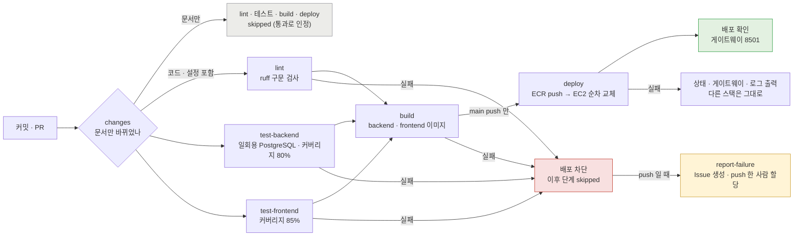

# MOA 파이프라인 구현 결과 보고서

| 속성      | 값                                                                                                     |
| --------- | ------------------------------------------------------------------------------------------------------ |
| 문서 버전 | v1.0                                                                                                   |
| 작성일    | 2026-11-06                                                                                             |
| 기준 실행 | main `0cf85ac` · [42172032831](https://github.com/poohoot-ai/2026_aio2_moa/actions/runs/42172032831) |
| 상태      | 완료                                                                                                   |

> **요약**
> GitHub Actions 워크플로 `CI / CD` 하나로 검사 → 빌드 → 무중단 배포까지 자동화했다. 필수 검사 4종이 실패하면 PR 은 merge 되지 않고 배포도 일어나지 않는다. 2026-11-05 ~ 06 main 실행 11회 중 9회 성공, 실패 2회는 원인을 고쳐 재발하지 않았다.

---

## 1. 한눈에 보기

| 항목      | 내용                                                                                                                               |
| --------- | ---------------------------------------------------------------------------------------------------------------------------------- |
| 도구      | GitHub Actions (`CI / CD` 1개) · AWS ECR · AWS EC2 (Docker Engine 1대)                                                         |
| 트리거    | `main` · `dev` push · 그쪽으로 향하는 PR · 실증 전용 `demo/ci-fail-*` push (#104)                                         |
| 단계      | `changes` → `lint` · `test-backend` · `test-frontend` → `build` → `deploy`(main 만) · 실패 시 `report-failure` |
| 차단      | 필수 검사 4종 실패 PR 은 merge 불가 · 어느 검사든 실패하면 build · deploy 미실행                                                 |
| 배포      | 앱 스택 A → 게이트웨이 UP 확인 → B 순차 교체(무중단) → 운영 대시보드 `moa-ops` 교체 · 배포 전 DB 백업                        |
| 알림      | push 에서 검사 · 빌드 실패 시 GitHub Issue 자동 생성 · push 한 사람 할당                                                         |
| 운영 실적 | main 실행 11회 — 성공 9 · 실패 2 (7절)                                                                                           |

**핵심 수치**

| 지표                   | 기준      | 실측                                            |
| ---------------------- | --------- | ----------------------------------------------- |
| backend 커버리지       | 80%       | **84.64%**                                |
| frontend 커버리지      | 85%       | **99.30%**                                |
| backend 테스트         | 전부 통과 | **592 통과** (4 skipped · 1 xfailed)     |
| frontend 테스트        | 전부 통과 | **109 통과**                              |
| 무중단 배포 소요       | —        | A 10초 → B 9초 → moa-ops 8초 · 전체 4분 50초 |
| 장애 전환 시간 (SC-12) | 15초 이내 | **2.1초**                                 |

---

## 2. 파이프라인 다이어그램

### 2.1 전체 흐름

### 2.2 배포 단계 안 (`scripts/deploy.sh`)

---

## 3. 단계별 입력 · 출력 · 실패 처리

### `changes`

- **언제**: 모든 트리거
- **입력**: 커밋 범위 (PR: base…head, push: before..after)
- **하는 일**: 바뀐 파일이 `docs/**` · `README.md` 뿐인지 판정. `backend/prompts/*.md` 는 코드로 본다
- **출력**: `code=true/false`
- **실패하면**: 판정 불가 · 실패 → 안전하게 전체 실행

### `lint`

- **언제**: 문서 외 변경
- **입력**: backend · frontend 소스
- **하는 일**: `ruff check --select E9,F63,F7,F82` — 구문 오류 · 잘못된 비교 · 문장 위치 · 정의 안 된 이름
- **출력**: GitHub 주석
- **실패하면**: merge 불가(필수 검사) · 배포 차단

### `test-backend`

- **언제**: 문서 외 변경
- **입력**: 소스 · 일회용 PostgreSQL 15 · `sql/run_sql.py` 스키마 · 시드
- **하는 일**: `pytest --cov=app --cov-fail-under=80` — 계약 · 규칙 · 전체 흐름(`MOA_LIVE_DB=1`)
- **출력**: 테스트 결과 · 커버리지
- **실패하면**: merge 불가(필수 검사) · 배포 차단

### `test-frontend`

- **언제**: 문서 외 변경
- **입력**: frontend 소스
- **하는 일**: `pytest --cov=api_client --cov-fail-under=85` — 백엔드 호출부
- **출력**: 테스트 결과 · 커버리지
- **실패하면**: merge 불가(필수 검사) · 배포 차단

### `build`

- **언제**: 세 검사 통과
- **입력**: Dockerfile 2개
- **하는 일**: backend · frontend 이미지 빌드
- **출력**: 빌드 가능 여부
- **실패하면**: merge 불가(필수 검사) · 배포 차단

### `deploy`

- **언제**: **main push** + build 통과
- **입력**: 이미지 · compose · 게이트웨이/소켓 프록시 설정 · 스크립트 · Secrets
- **하는 일**: ECR push(sha + latest) → 러너 IP 를 22번에 잠깐 허용 → 파일 복사(tar) → `deploy.sh` → 8501 확인 → 22번 회수(항상)
- **출력**: 운영 반영 · 배포 로그
- **실패하면**: 스크립트가 멈춘 지점에서 중단(A 실패 시 B 유지) · 상태 · 로그 출력

### `report-failure`

- **언제**: push 에서 위 검사 · 빌드 실패
- **입력**: 실행 정보
- **하는 일**: `[CI 실패] <브랜치> <sha>` Issue 생성 · push 한 사람(`GITHUB_ACTOR`) 할당 (할당 실패 시 할당 없이 생성)
- **출력**: Issue

---

## 4. 블로킹 정책

| 구분              | 규칙                                                                                                                                          | 근거                                                                                         |
| ----------------- | --------------------------------------------------------------------------------------------------------------------------------------------- | -------------------------------------------------------------------------------------------- |
| PR → dev · main | 룰셋 `dev-main-protect`: PR 필수 · 필수 검사 `lint` · `test-backend` · `test-frontend` · `build` 통과 · 강제 push · 삭제 금지 | GitHub 룰셋 · `lint` 는 [PRD](PRD.md) v1.2 9.2 · `lint` · `build` 는 2026-11-06 추가 |
| 잡 사이           | `build` 는 세 검사가 **모두 성공**해야, `deploy` 는 `build` 성공 + main push 일 때만                                              | `needs` · `if`                                                                          |
| 문서만 바뀐 변경  | `changes` 가 이후 잡을 skipped — 필수 검사는 skipped 를 통과로 인정 → merge 가능 · 배포 없음                                             | PR #100 (실행 42134176396: changes 성공 · 나머지 6개 skipped)                               |
| 배포 안           | 두 앱 스택을 동시에 내리지 않는다. A 가 healthy · 게이트웨이 UP 이 안 되면 B 는 교체하지 않고 실패                                           | `deploy.sh`                                                                                |
| 배포 동시 실행    | `concurrency: deploy-production` — 한 번에 하나, 진행 중인 배포는 취소하지 않는다                                                          | `ci.yml`                                                                                   |

> **필수 검사 보강**
> 처음에는 `test-backend` · `test-frontend` 만 필수 검사라, 정적 검사 · 이미지 빌드(Dockerfile · 의존성 설치)만 깨진 PR 은 merge 되고 main 에서야 배포가 막혔다. PRD v1.2 9.2 에 따라 `lint` 를, 같은 이유로 `build` 를 필수 검사에 더해 이제 CI 의 모든 검사가 PR 단계에서 merge 를 막는다. 문서만 바뀐 PR 은 넷 다 skipped(통과 인정)로 그대로 merge 된다(PR #103 확인).

---

## 5. 커버리지 기준 · 테스트 데이터

| 대상     | 기준                      | 측정 범위                             | 최근 실측        |
| -------- | ------------------------- | ------------------------------------- | ---------------- |
| backend  | **80%** (PRD SC-10) | `app` 패키지 전체                   | **84.64%** |
| frontend | **85%**             | `api_client` (화면 `app.py` 제외) | **99.30%** |

실측 기준: 2026-11-06 · main `0cf85ac` · 실행 42172032831

- **기준 미만이면 실패** — 테스트가 모두 통과해도 실패한다. 테스트를 지워 통과시키는 변경을 막는다
- **테스트 데이터** — CI 마다 일회용 PostgreSQL 컨테이너를 새로 띄우고 `sql/run_sql.py` 로 롤 → 스키마 → 뷰 → 메뉴 시드를 적재한다(데모 시드 제외). 운영 DB 와 섞이지 않고 실행마다 같은 상태에서 시작한다
- **LLM** — CI 는 모의 응답으로 돈다(기획서 6절 "CI는 모의 LLM"). 같은 입력에 같은 결과, 비용 없음
- **비밀값** — CI 전용 값(`ci-app-rw` 등)은 워크플로 env 에만 둔다. 운영 비밀값은 GitHub Secrets · 서버 `.env` 에만
- **배포 구성 테스트** — TC-133 compose guard(25건): 외부 포트는 게이트웨이뿐 · restart 정책 · DB 는 공용 스택에만 · 스택 격리 · docker.sock 은 socket-proxy 만 · 모든 컨테이너 메모리 · 로그 제한 · 로그 보존
- **테스트 건수** — backend **592 통과**(4 skipped · 1 xfailed) · frontend **109 통과**

---

## 6. 실패 알림 · 담당자 할당 · 에스컬레이션

| 실패 지점                                                   | 알림                                                                       | 담당                   | 다음 단계                                             |
| ----------------------------------------------------------- | -------------------------------------------------------------------------- | ---------------------- | ----------------------------------------------------- |
| PR 의 검사 실패                                             | PR 화면 빨간 X · merge 버튼 막힘                                          | PR 작성자              | 고쳐서 다시 push                                      |
| dev · main · `demo/ci-fail-*` push 의 검사 · 빌드 실패 | **GitHub Issue 자동 생성** `[CI 실패] <브랜치> <sha>` · 실행 링크 | push 한 사람 자동 할당 | 고쳐서 PR                                             |
| 배포 실패                                                   | 실행 기록에 컨테이너 상태 · 게이트웨이 A/B 상태 · 로그 30줄              | 배포 담당              | 운영 상태 확인 → 수동 복구(D-03 7.4) → 원인 수정 PR |
| 운영 중 장애 (배포 밖)                                      | healing 사건 · 운영 대시보드 승인 요청                                    | healing · 운영자      | PRD 8절                                               |

**에스컬레이션 순서**

1. 자동 차단 — 이후 단계 skipped · merge 막힘
2. Issue 자동 할당 — push 한 사람
3. 배포 실패 — 배포 담당이 실행 기록의 상태 출력으로 판단 · 수동 복구
4. 원인 수정 PR · D-03 7.5 배포 기록

> **실증 상태**
> dev · main 은 PR 로만 들어가고 필수 검사 실패 PR 은 merge 되지 않아, 평소 흐름에서는 push 실패가 나지 않는다. 그래서 실증 전용 브랜치 패턴 `demo/ci-fail-*` 를 push 트리거에 더했다(#104 · dev `a9eaf64`). 이 브랜치에 깨진 커밋을 push 하면 `report-failure` 가 돈다. `deploy` 는 main push 만이라 운영 영향 없음.
> **R7.2 담당(QA)이 2026-11-06 실증 완료** — Issue #106(SC-11) · #109(SC-10) 자동 생성 · push 한 QA 계정에 할당 (8.2 · 8.3)

> **빈틈**
> 배포 실패는 Issue 대상이 아니다(`report-failure` 의 `needs` 에 `deploy` 가 없다). 2026-11-05 배포 실패 때 Issue 가 생기지 않았다 — #68 에 전달

---

## 7. 실행 기록 (main)

| 실행 ID                                                                            | 시각 (UTC)  | 내용                                                                                     | 결과                                                                                                                          |
| ---------------------------------------------------------------------------------- | ----------- | ---------------------------------------------------------------------------------------- | ----------------------------------------------------------------------------------------------------------------------------- |
| [41950911480](https://github.com/poohoot-ai/2026_aio2_moa/actions/runs/41950911480) | 11-05 01:47 | 단일 compose 시절 배포                                                                   | **실패** — SSH 키 준비 단계(러너가 22번에 접속 못 함). 러너 IP 를 배포 동안만 보안 그룹에 허용하도록 고친 뒤(#83) 성공 |
| [41989677571](https://github.com/poohoot-ai/2026_aio2_moa/actions/runs/41989677571) | 11-05 07:47 | 새 배포 구성 첫 배포 (#91)                                                               | **실패** — 아래 실패 사례 참조                                                                                         |
| [41993381672](https://github.com/poohoot-ai/2026_aio2_moa/actions/runs/41993381672) | 11-05 08:17 | `deploy.sh` 수정 (#94) — 새 구성 첫 CI 무중단 배포                                    | 성공 · A 12초 → B 9초                                                                                                       |
| [41997227316](https://github.com/poohoot-ai/2026_aio2_moa/actions/runs/41997227316) | 11-05 08:47 | 이중화 시험 도구 · 문서 건너뛰기 (#97)                                                  | 성공                                                                                                                          |
| [42000792055](https://github.com/poohoot-ai/2026_aio2_moa/actions/runs/42000792055) | 11-05 09:14 | 옛 이미지 정리 · 로그 보존 (#99)                                                        | 성공 · 옛 이미지 10개 정리                                                                                                   |
| [42138964019](https://github.com/poohoot-ai/2026_aio2_moa/actions/runs/42138964019) | 11-06 00:44 | 재부팅 뒤 자동 재시작 수정 · 로그 제한 · DB 백업 (#102)                                | 성공 · 중단된 운영을 이 배포로 복구 · 배포 전 백업 첫 생성                                                                  |
| [42165874533](https://github.com/poohoot-ai/2026_aio2_moa/actions/runs/42165874533) | 11-06 05:01 | 운영 대시보드 전용 스택 `moa-ops` 추가 · `demo/ci-fail-*` 트리거 · PRD v1.2 (#114) | 성공 · A 10초 → B 9초 → moa-ops 7초                                                                                        |
| [42172032831](https://github.com/poohoot-ai/2026_aio2_moa/actions/runs/42172032831) | 11-06 06:03 | 운영 대시보드 8502 로그인 정리 · PRD v1.3 (#118) — **이 보고서의 기준 실행**     | 성공 · 7개 잡 중 6개 성공(`report-failure` 는 실패가 없어 skipped) · A 10초 → B 9초 → moa-ops 8초 · 전체 4분 50초      |

> **배포 실패 사례 (41989677571)**
> 운영 DB 에 F-1 장애 주입이 켜져 해석 서비스 `/health` 가 503 → `deploy.sh` 가 200 만 기다리다 60초 뒤 실패. 옛 단일 스택은 지운 뒤라 운영 8501 이 약 10분 중단. 배포 담당이 앱 스택을 수동으로 올려 복구(데이터 그대로)하고, 대기 판정을 "HTTP 로 답하면 떠 있음"으로 고쳐 다음 배포부터 통과(#92).
> **교훈**: 배포 스크립트는 장애 주입 같은 운영 상태에 막히지 않아야 한다 — 로컬에서 같은 상태를 재현해 검증한 뒤 반영.

> **이중화 배포 시험**
> 운영 서버에서 `scripts/dep-test.sh` (2026-11-06 00:52 UTC): DEP-1 ~ 4 의 16개 항목 모두 통과. A 중지 시 감지 · 전환 2.1초(SC-12 기준 15초), 재등록 0.8 ~ 2.2초. 순차 배포 중 요청 180건 모두 200(로컬).

---

## 8. 증빙 목록

- [X] **파이프라인 흐름** — 2절 다이어그램 · `ci.yml`
- [X] **문서만 바뀐 변경의 건너뛰기** — 실행 42134176396 (PR #100)
- [X] **순차 무중단 배포** — 7절 실행 기록 · deploy 로그 · 로컬 요청 180건
- [X] **배포 실패 시 처리 · 복구** — 실행 41989677571 · D-03 7.5 · #92
- [X] **SC-7 배포 차단 실증** — PR #105 · 실행 [42144187495](https://github.com/poohoot-ai/2026_aio2_moa/actions/runs/42144187495) → 8.1 (QA · R7.1)
- [X] **SC-10 커버리지 미달 실패** — `demo/ci-fail-sc10` · 실행 [42155875280](https://github.com/poohoot-ai/2026_aio2_moa/actions/runs/42155875280) · Issue #109 → 8.2 (QA · R7.2)
- [X] **SC-11 Issue 자동 생성 · 할당** — `demo/ci-fail-sc11` · 실행 [42150224592](https://github.com/poohoot-ai/2026_aio2_moa/actions/runs/42150224592) · Issue #106 → 8.3 (QA · R7.2)
- [X] **기준 커밋 실행 · 커버리지 · 테스트 건수** — main `0cf85ac` · 실행 [42172032831](https://github.com/poohoot-ai/2026_aio2_moa/actions/runs/42172032831): backend 84.64% · 592 통과, frontend 99.30% · 109 통과, 배포 성공 → 5절 · 7절

### 8.1 SC-7 배포 차단 실증

| 항목        | 값                                                                                                                                                                                               |
| ----------- | ------------------------------------------------------------------------------------------------------------------------------------------------------------------------------------------------ |
| PR          | #105 `demo/r7.1-broken-amount` → `dev` (merge 없이 닫음)                                                                                                                                    |
| 망가뜨린 것 | `settlement.item_price()` 가 예상 금액에 수량을 곱하지 않음 — 2잔이어도 1잔 값                                                                                                                |
| 커밋        | `6a47ec9`                                                                                                                                                                                      |
| 실행        | `CI / CD` #70 · [42144187495](https://github.com/poohoot-ai/2026_aio2_moa/actions/runs/42144187495) (pull_request · 47초)                                                                     |
| 결과        | `changes` · `lint` · `test-frontend` 성공 · **`test-backend` 실패**(필수 검사) → `build` · `deploy` · `report-failure` skipped · **merge 버튼 비활성**          |
| 잡은 테스트 | `test_menu_options.py::test_price_uses_the_menu_scope` — `(6100, 6100) == (6100, 12200)` · `test_q03_validation.py::test_person_totals_add_up_to_the_item_total` — `4500 == 4500 * 2` |

**실행 화면** — `test-backend` 실패 뒤 `build` · `deploy` 가 돌지 않았다

#70#70 — test-backend 실패 · build · deploy skipped" />

**PR 검사 · merge 영역** — 필수 검사 `test-backend` 실패(Required) · merge 버튼 비활성

#105#105 검사 — 1 failing · 3 skipped · merge 막힘" />

### 8.2 SC-10 커버리지 미달 실패

| 항목         | 값                                                                                                                                                                                               |
| ------------ | ------------------------------------------------------------------------------------------------------------------------------------------------------------------------------------------------ |
| 브랜치       | `demo/ci-fail-sc10` (dev 에서 분기 · 확인 뒤 삭제)                                                                                                                                            |
| 바꾼 것      | backend 테스트 파일 6개 삭제 — `test_live_flow.py` · `test_api_contract.py` · `test_intake_rules.py` · `test_q03_flow_guards.py` · `test_sbux_options.py` · `test_tools.py`    |
| 커밋 · 실행 | `1f308fd` · `CI / CD` #84 · [42155875280](https://github.com/poohoot-ai/2026_aio2_moa/actions/runs/42155875280) (push · 1분 2초)                                                           |
| 결과         | **남은 테스트 343개 모두 통과**(1 xfailed)했지만 커버리지 **74.29%** < 기준 80% → `test-backend` 실패 → `build` · `deploy` skipped · `report-failure` 가 Issue #109 생성 |
| 의미         | 테스트를 지워 통과시키는 변경을 커버리지 기준이 막는다                                                                                                                                           |

> **시도 경과**
> 앞선 실행 중 #78 · #80 ~ #83 다섯 번은 지운 테스트가 적어 커버리지가 80% 이상이라 통과했고, #79 는 다른 테스트가 지운 모듈을 import 해 수집 오류로 실패했다(커버리지 미달이 아니므로 SC-10 증빙에서 제외 · Issue #108). 기준이 실제로 작동하는 지점은 #84 다.

**실행 화면** — `test-backend` 실패 · `build` · `deploy` skipped · `report-failure` 실행

#84#84 — test-backend 실패 · report-failure 성공" />

**test-backend 로그** — 테스트는 모두 통과, 커버리지 미달로 실패

### 8.3 SC-11 실패 Issue 자동 생성 · 할당

QA 확인: R7.2 · 2026-11-06

| 항목         | 값                                                                                                                                                                            |
| ------------ | ----------------------------------------------------------------------------------------------------------------------------------------------------------------------------- |
| 브랜치       | `demo/ci-fail-sc11` (dev 에서 분기 · 확인 뒤 삭제)                                                                                                                         |
| 바꾼 것      | 반드시 실패하는 테스트 1개 추가 (`backend/tests/test_sc11_ci_failure.py`)                                                                                                   |
| 커밋 · 실행 | `674d487` · `CI / CD` #75 · [42150224592](https://github.com/poohoot-ai/2026_aio2_moa/actions/runs/42150224592) (push · 54초)                                           |
| 결과         | `test-backend` 실패 → `build` · `deploy` skipped · **`report-failure` 성공**                                                                                 |
| 생성된 Issue | #106 `[CI 실패] demo/ci-fail-sc11 674d487` — 작성 github-actions · 본문에 브랜치 · 커밋 · 작성자 · 실행 링크 · **`akfxkfkd135-collab`(push 한 QA) 자동 할당** |

> **참고**
> 브랜치를 지운 뒤 커밋 화면에 "This commit does not belong to any branch" 경고가 뜨는 것은 실증 브랜치를 정리했기 때문이다(포크 아님). 실행 기록 · Issue 링크는 그대로 남는다.

**실행 화면** — `test-backend` 실패 뒤 `report-failure` 가 돌았다

#75#75 — test-backend 실패 · report-failure 성공" />

**자동 생성된 Issue** — github-actions 가 만들고 push 한 사람에게 할당

#106#106 — github-actions 생성 · akfxkfkd135-collab 할당" />
